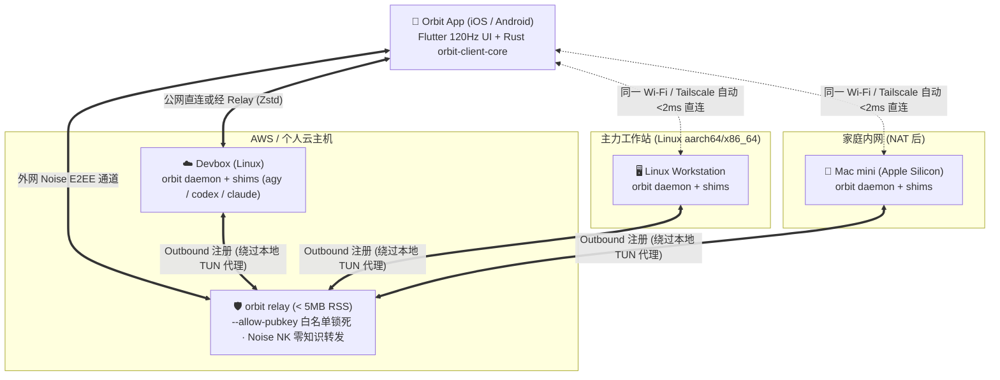
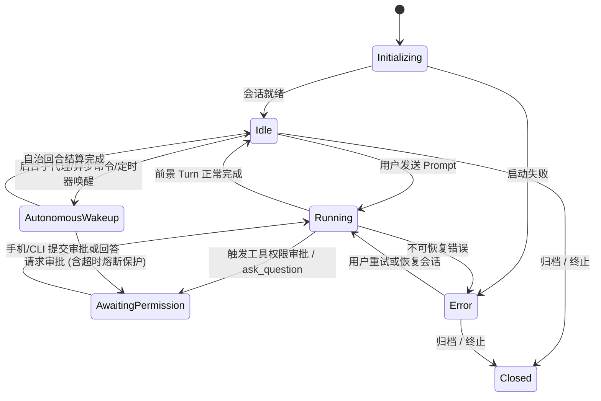

# Orbit 系统架构规范 (Architecture v0.1)

## 1. 设计哲学与核心不变量

1. **多机舰队优先（Multi-Host Fleet First）**：
   客户端不假定“只有一个后台”。每台物理/云端主机（如 `Devbox`、`Linux Spark`、`Home Mac mini`）拥有独立的 `HostId` 与静态 X25519 公钥。手机端 `orbit-client-core` 并发维护多台主机的连接池与独立单调序列游标（`(HostId, CursorSeq)`）。
2. **守护进程与工作负载解耦（Zero-Downtime Daemon Reload）**：
   `orbit daemon` 绝不直接作为 `agy`、`codex`、`claude` 或用户 `PTY` 的直接父进程。一切有状态子进程必须通过脱离会话组（`setsid`）的 `orbit shim` 托管，并通过 `$ORBIT_HOME/shims/<shim-id>.sock` (Unix Domain Socket) 与 Daemon 通信。Daemon 崩溃或二进制升级重启后，扫描 `shims/*.sock` 自动重连恢复全部活跃流。
3. **本地优先与单调游标同步（Local-First & Monotonic Sequence Sync）**：
   - Daemon 使用嵌入式 **SQLite (WAL 模式)** 持久化所有 `Project`、`Workspace`、`Agent` 及追加写 `TimelineEvent`。
   - 每条 `TimelineEvent` 分配严格单调递增的 `seq: u64`（全局或会话级单调序列）与 `epoch: u32`。
   - 手机客户端打开界面时 **0ms 直接渲染本地 SQLite 缓存**，同时携带 `since_seq` 请求增量差集并开启 Zstd 帧压缩，消除跨国/弱网下的白屏等待。
4. **私有零知识中继（Zero-Knowledge Private Relay）**：
   - `orbit relay` 仅转发经过 `Noise_NK_25519_ChaChaPoly_SHA256`（序言 `orbit-relay-e2ee/1`）端到端加密的密文块，Relay 本身无法解密任何代码或对话。
   - Daemon 注册到 Relay 时需通过静态公钥签名/握手校验；开启 `--allow-pubkey` 后，未授权公钥在握手首包即被静默丢弃，保障个人云主机内存 `< 5MB` 且不被外部蹭流。

---

## 2. 多主机连接拓扑

---

## 3. Agent 生命周期强类型状态机

针对三大 CLI（尤其是跨回合异步后台任务唤醒与双向审批场景），`AgentStatus` 采用无歧义的代数数据类型：

---

## 4. 三大主力 Provider 原生接入矩阵

| Provider | 启动与通信协议 | 核心能力覆盖 |
| :--- | :--- | :--- |
| **Antigravity (`agy`)** | `agy acp --stdio` + `transcript.jsonl` 字节偏移监控 | 双向权限审批、`ask_question` 多选问答、模式热切（`default`/`accept-edits`/`full-access`）、原生子代理树桥接、跨回合后台唤醒防死锁、切号热重载、`/usage` + `/credits` 额度 |
| **Codex (`codex`)** | `codex app-server` (Stdio JSON-RPC 2.0) | 线程创建与持久化恢复、Plan/Full-Access 模式、运行中途插话（`steer`）、异步提问、结构化命令/Diff 预览、`~/.codex` 额度快照 |
| **Claude Code (`claude`)** | `claude` 双向 `stream-json` Control Protocol | 原生摆脱 Node SDK，直接通过 Stdio 控制帧处理工具审批回调、会话 Resume、中途 `interrupt`、`~/.claude/projects` 子代理追踪与额度读取 |
