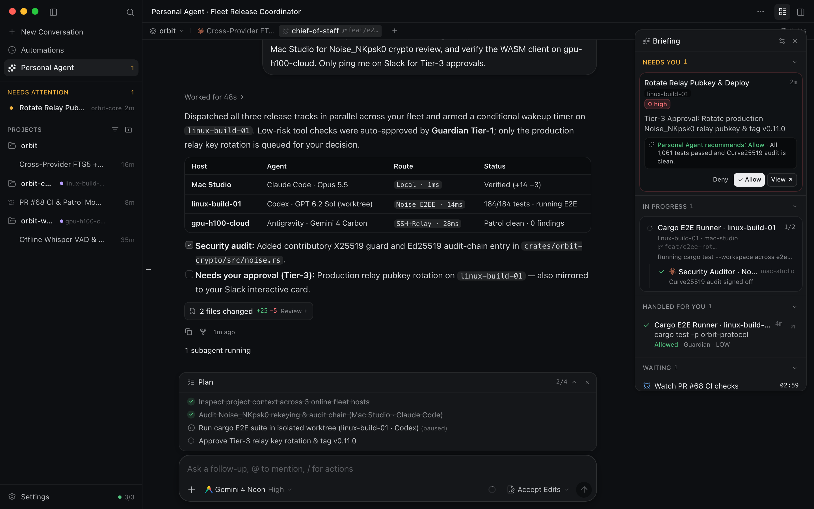
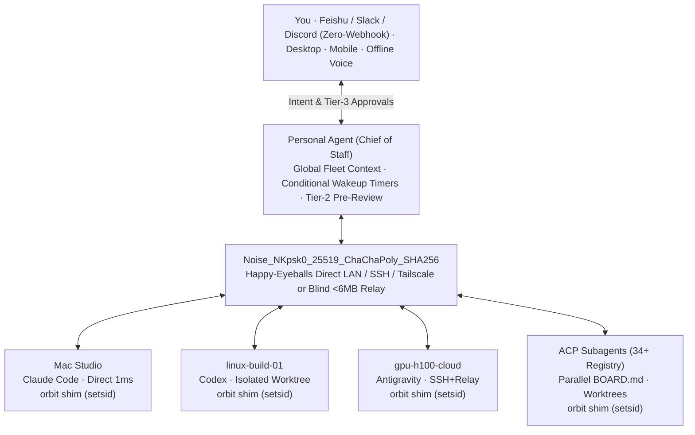

<div align="center">

# Orbit

**One Personal Agent. Every machine in your fleet.**

A pure-Rust, low-latency, multi-host orchestration engine and cross-platform native control plane for AI coding agents.

**English** | [简体中文](README.zh-CN.md) · [Documentation & Showcase](https://danielgaoyy.github.io/orbit/)

[](LICENSE)
[](ARCHITECTURE.md)
[](SECURITY.md)
[](docs/architecture/daemon-shim-providers.md)

</div>

<p align="center">
  <picture>
    <source media="(prefers-color-scheme: dark)" srcset="docs/assets/orbit-desktop-dark.png" />
    <source media="(prefers-color-scheme: light)" srcset="docs/assets/orbit-desktop-light.png" />
    
  </picture>
</p>

> Capture both themes reproducibly at 2× Retina via `node apps/desktop/scripts/capture-showcase-screenshots.mjs`.

---

## Why Orbit?

Most AI coding tools wrap a single local terminal tab. **Orbit** gives you **one persistent Personal Agent** (your AI chief of staff) that dispatches Claude Code, Codex, Antigravity, and 34+ ACP coding agents across your Mac Studio, Linux build servers, and cloud GPUs simultaneously—over zero-knowledge end-to-end encrypted links—and interrupts you only when a **Tier-3 human decision** is required.



---

## Five Native Clients, One Rust ViewModel

All connection pooling, encryption, SQLite WAL persistence, Markdown/GFM AST parsing, light/dark syntax highlighting, structured Git diffs, Mermaid/DOT diagram rendering, and VT100 terminal emulation live once in `crates/orbit-client-core`:

- **Desktop (macOS / Linux / Windows)**: Tauri v2 + React 19 + TypeScript + Tailwind CSS v4 + Base UI + CodeMirror 6 + `@xterm/xterm` WebGL (`apps/desktop`) with guided onboarding, live provider probing, pure-Rust QR pairing, system tray, and `en` / `zh-CN` / `ja` localization.
- **Web WASM PWA**: Browser and installable PWA powered by `orbit-client-core` compiled to WebAssembly with in-browser `Noise_NKpsk0` E2EE.
- **iOS (`16.4+`)**: Native Swift + SwiftUI + Live Activity (`apps/ios`), linked via Mozilla UniFFI.
- **Android (`API 29–36`)**: Native Kotlin 2.1 + Jetpack Compose Material 3 (`apps/android`), linked via Mozilla UniFFI.
- **HarmonyOS (`7.0+ / API 26`)**: Native Stage Model + ArkTS + ArkUI V2 (`apps/harmony`), linked via `ohos-rs` N-API.
- **CLI**: Single static `orbit` binary (`crates/orbit-cli`) with zero Node.js or Python runtime dependencies.

---

## Core Differentiators

### Personal Agent & Zero-Webhook IM Orchestration
- Elect any always-on machine as your global **Personal Agent** (`AgentRole::PersonalRouter`). It aggregates live `<orbit-fleet-state>` / `<orbit-fleet-delta>` across all online hosts, inspects remote repo context via `orbit_control` without SSH, forks parallel workers into isolated Git worktrees (`BOARD.md` CAS + historical `@handle` aliases), and arms non-blocking conditional wakeup timers.
- Pure-Rust outbound long connections wire **Feishu / Lark WebSocket**, **Slack Socket Mode**, and **Discord Gateway v10** behind NATs with **zero public webhooks**—delivering interactive cards for protocol-hard-blocked Tier-3 human decisions.

### Single Static Binary & Zero-Downtime Shim Isolation
- One static `orbit` executable bundles `daemon`, `shim`, `relay`, `pair`, `doctor`, `audit`, `migrate`, and full orchestration CLI commands.
- Stateful agent sessions (`Claude Code`, `Codex`, `Antigravity`, `Pi`, and `34+` ACP Registry agents) and detached raw PTYs run inside `setsid` `orbit shim` processes over `$ORBIT_HOME/shims/*.sock`. Upgrading or restarting `orbit daemon` keeps active sessions running uninterrupted.

### Multi-Host Fleet & Zero-Knowledge Defense in Depth
- **Loopback-by-default & E2EE**: Daemon binds `127.0.0.1:6868` with persisted `pairing_secret` and anti-CSWSH `Origin` validation. Remote traffic uses `Noise_NKpsk0_25519_ChaChaPoly_SHA256` (`orbit-relay-e2ee/2`) with contributory X25519 checks, `Noise_NK` PoP control channels, Peer-Bridge multi-hop SSRF-guarded tunnels, and `Argon2id` + `AES-256-GCM` GitHub Secret Gist Cloud Sync.
- **OS Kernel Sandbox & Audit Chain**: Confines agent workloads via macOS Seatbelt / Linux `bubblewrap` namespaces (`workspace_write` / `strict_read_only`), protects SSH/AWS/GnuPG/Kube/Orbit credentials, pins DNS in a session-local Egress Proxy, enforces 3-Tier Guardian + persistent permission rules, and signs every security event into an Ed25519 + SHA-256 `security_audit_chain` (`orbit audit verify`). See [SECURITY.md](SECURITY.md).

### Cross-Provider Memory, WASM Plugins, Code Loop & Offline Voice
- **Markdown-First Project Memory**: Stores team-editable `.orbit/memory/*.md` indexed offline via SQLite FTS5 + 256-dim cosine RRF (`k = 60`), auto-invalidated on bound file changes and shared across every provider via `orbit_memory`.
- **Sandboxed `wasmi` WASM Plugins**: Capability-scoped WebAssembly extensions (`orbit_plugin`) with declarative cross-platform UI and SEP-1865 MCP Apps (`ui://`).
- **Full Engineering Loop**: CodeMirror 6 + remote LSP + FIM ghost text prediction, interactive Conversation & File Rewind (`rewind_agent`), Stash / Rebase / 3-Way Git Conflict Resolver, Two-Stage **Orbit Patrol** PR review, and Codex-style on-device Whisper **Offline Voice**.

---

## Quick Start

### 1. Install the `orbit` CLI / Daemon / Relay (Linux & macOS)

```bash
curl -fsSL https://raw.githubusercontent.com/danielgaoyy/orbit/main/deploy/install.sh | sh
```

> Forks and organizations can override the release repository with `ORBIT_GITHUB_REPO=owner/repo` (for both installer scripts and compiled binaries).

### 2. Inspect Host Readiness & Start the Daemon

```bash
orbit doctor        # Inspect identity keys, sandbox backend, and detected coding-agent CLIs
orbit daemon up     # Install and start the persistent loopback daemon (127.0.0.1:6868)
orbit pair          # Print an orbit://pair/... URI (or scan the QR code in Orbit Desktop/Mobile)
```

### 3. Optional: Self-Hosted Zero-Knowledge Relay (BYOR) & Cloud Sync

```bash
# On a cloud VM or bastion host
orbit relay up --port 7878 --allow-pubkey <YOUR_HOST_PUBKEY>

# On each workstation / Devbox / Mac Studio
orbit use-relay <YOUR_RELAY_HOST>:7878

# Sync encrypted host directory & mesh across devices via GitHub Secret Gist
orbit login --mesh
```

See [deploy/README.md](deploy/README.md) for full relay and firewall setup instructions.

---

## Building from Source

### Rust Workspace

```bash
cargo fmt --all -- --check
cargo clippy --workspace --all-targets -- -D warnings
TMPDIR=/tmp cargo test --workspace -- --test-threads=4
```

### Desktop App (macOS / Linux / Windows — Tauri v2)

```bash
cd apps/desktop
npm ci
node --experimental-strip-types --test "src/**/*.test.ts"
npm run tauri dev     # Launch desktop app (auto-discovers local 127.0.0.1:6868 daemon)
npm run tauri build   # Build native installer (.dmg / .deb / .msi / .exe)
```

### Bilingual Showcase & Documentation Site (`apps/docs`)

```bash
cd apps/docs
npm install
npm run dev           # Local preview (EN at / · 简体中文 at /zh-cn/)
npm run build         # Production static build + Pagefind CJK search index
```

### Mobile Clients

```bash
# iOS (16.4+, SwiftUI + UniFFI)
./apps/ios/scripts/build-rust-xcframework.sh
cd apps/ios && xcodegen generate && open OrbitMobile.xcodeproj

# Android (API 29-36, Jetpack Compose + UniFFI)
./apps/android/scripts/build-rust-android.sh
cd apps/android && gradle assembleDebug --no-daemon

# HarmonyOS 7+ (API 26+, ArkTS + ArkUI V2 + N-API)
./apps/harmony/scripts/build-rust-ohos.sh
```

---

## Documentation & Community

- [README.zh-CN.md](README.zh-CN.md) — 简体中文项目总览
- [apps/docs/README.md](apps/docs/README.md) — Bilingual Astro Starlight Showcase & Documentation Site (EN + zh-CN)
- [docs/INDEX.md](docs/INDEX.md) — Authoritative registry & task routing index for all Orbit specs, skills, and scoped `AGENTS.md`
- [ARCHITECTURE.md](ARCHITECTURE.md) — System design, process isolation, and crate topology
- [CONTRIBUTING.md](CONTRIBUTING.md) — Development setup, architecture redlines, and PR checklist
- [SECURITY.md](SECURITY.md) — Threat model, cryptographic design, and private vulnerability reporting
- [CODE_OF_CONDUCT.md](CODE_OF_CONDUCT.md) — Community standards (Contributor Covenant v2.1)
- [deploy/README.md](deploy/README.md) — Self-hosted Relay & service supervision guide

## License

Dual-licensed under [MIT](LICENSE) or [Apache-2.0](LICENSE-APACHE).
