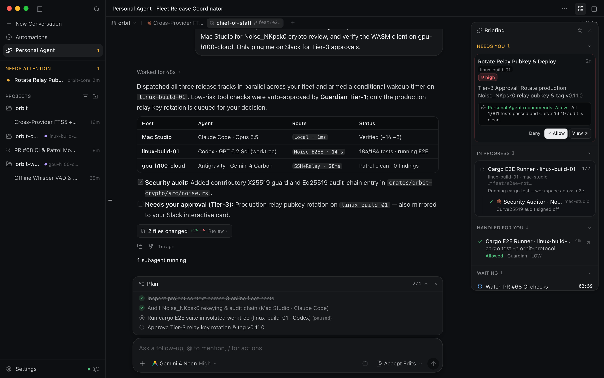
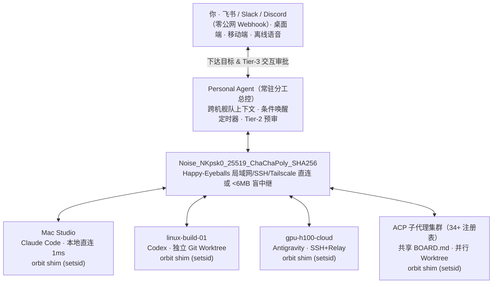

<div align="center">

# Orbit

**一个 Personal Agent，调度你全部机器上的 AI 编码舰队。**

纯 Rust 构建的低延迟、多主机 AI 编码代理编排引擎与跨平台原生控制平面。

[English](README.md) | **简体中文** · [双语官网与文档中心](https://danielgaoyy.github.io/orbit/zh-cn/)

[](LICENSE)
[](ARCHITECTURE.md)
[](SECURITY.md)
[](docs/architecture/daemon-shim-providers.md)

</div>

<p align="center">
  <picture>
    <source media="(prefers-color-scheme: dark)" srcset="docs/assets/orbit-desktop-dark.png" />
    <source media="(prefers-color-scheme: light)" srcset="docs/assets/orbit-desktop-light.png" />
    
  </picture>
</p>

> 可随时通过 `node apps/desktop/scripts/capture-showcase-screenshots.mjs` 一键复现 2× Retina 深浅双色截图。

---

## 为什么选择 Orbit？

绝大多数 AI 编程工具只是单机终端的一层外壳。**Orbit** 为你提供**唯一常驻的 Personal Agent（你的 AI 工程总参谋）**——通过零知识端到端加密网络，同时调度 Mac Studio 上的 Claude Code、Linux 构建机上的 Codex、云端 GPU 上的 Antigravity 以及独立 Git Worktree 中的 34+ ACP 代理，并仅在需要 **Tier-3 人类高危拍板** 时打扰你。



---

## 一套纯 Rust ViewModel，五端极致原生体验

多主机连接池、端到端加密、SQLite WAL 离线缓存、流式 CommonMark/GFM 解析、浅/深色语法高亮、结构化 Git Diff、Mermaid/DOT 图表渲染与 VT100 终端网格全部下沉在 `crates/orbit-client-core`：

- **Desktop（macOS / Linux / Windows）**：Tauri v2 + React 19 + TypeScript + Tailwind CSS v4 + Base UI + CodeMirror 6 + `@xterm/xterm` WebGL（`apps/desktop`），内置引导式配置、实时引擎探测、纯 Rust 二维码配对、系统托盘与 `en` / `zh-CN` / `ja` 三语界面。
- **Web WASM PWA**：基于编译为 WebAssembly 的 `orbit-client-core`，打开浏览器即可零安装使用并在端侧直接完成 `Noise_NKpsk0` 加密握手。
- **iOS（`16.4+`）**：原生 Swift + SwiftUI + Live Activity 灵动岛实时进度（`apps/ios`），经由 Mozilla UniFFI 直连 Rust 内核。
- **Android（`API 29–36`）**：原生 Kotlin 2.1 + Jetpack Compose Material 3（`apps/android`），经由 Mozilla UniFFI 直连 Rust 内核。
- **HarmonyOS（`7.0+ / API 26`）**：原生 Stage 模型 + ArkTS + ArkUI V2（`apps/harmony`），经由 `ohos-rs` N-API 直连 Rust 内核。
- **CLI**：单一静态 `orbit` 二进制（`crates/orbit-cli`），零 Node.js 与 Python 运行时依赖。

---

## 核心差异化特性

### Personal Agent 全局调度与零 Webhook IM 闭环
- 在线舰队中任意指定一台常驻机器作为全局 **Personal Agent**（`AgentRole::PersonalRouter`）：持续聚合全舰队 `<orbit-fleet-state>` / `<orbit-fleet-delta>`，免 SSH 通过 `orbit_control` 探测远端仓库上下文，在独立 Git Worktree 并行分派专家（支持 `BOARD.md` CAS 乐观锁与历史 `@handle` 别名），并以非打断排队与空闲条件定时器协同推进。
- 内置纯 Rust 主动出站长连接，无需公网域名或暴露端口即可在 NAT 后直连 **飞书 / Lark WebSocket**、**Slack Socket Mode** 与 **Discord Gateway v10**，将协议硬阻断的 Tier-3 风险审批以交互卡片直推手机。

### 单一静态二进制与零中断 Shim 热升级隔离
- 单个静态 `orbit` 文件内聚 `daemon`、`shim`、`relay`、`pair`、`doctor`、`audit`、`migrate` 与完整编排命令。
- 所有有状态代理（`Claude Code`、`Codex`、`Antigravity`、`Pi` 与 `34+` ACP 生态代理）及独立 Raw PTY 均运行于 `setsid` 脱离会话组的 `orbit shim` 中，通过 `$ORBIT_HOME/shims/*.sock` 通信——升级或重启 `orbit daemon` 绝不杀死运行中的 Agent。

### 多主机舰队与零知识纵深安全边界
- **默认回环与端到端加密**：Daemon 默认仅监听 `127.0.0.1:6868` 并强制 `pairing_secret` 与反 CSWSH `Origin` 校验；远程流量经 `Noise_NKpsk0_25519_ChaChaPoly_SHA256`（`orbit-relay-e2ee/2`）双向加密、支持 `Noise_NK` 控制信道 PoP、防 SSRF 的 Peer-Bridge 多跳隧道，以及基于 `Argon2id` + `AES-256-GCM` 的 GitHub Secret Gist 零知识云同步。
- **OS 内核沙箱与防篡改审计链**：通过 macOS Seatbelt / Linux `bubblewrap` 命名空间限制工作负载（`workspace_write` / `strict_read_only`），默认屏蔽 SSH/AWS/GnuPG/Kube/Orbit 凭据读取，配套 DNS 钉选防 SSRF 出站代理、三级 Guardian + 持久化权限规则，以及 Ed25519 + SHA-256 签名的 `security_audit_chain`（`orbit audit verify`）。详见 [SECURITY.md](SECURITY.md)。

### 跨引擎记忆、WASM 插件、代码审阅与离线语音
- **跨 Provider 项目记忆**：以可提交 Git 的 `.orbit/memory/*.md` 落盘，默认离线由 SQLite FTS5 + 256 维余弦相似度 RRF（`k = 60`）混合召回，源码变动自动标脏并经 `orbit_memory` 工具跨引擎共享。
- **`wasmi` 沙箱 WASM 插件**：无原生权限的 WebAssembly 插件运行时（`orbit_plugin`），提供跨端声明式 UI 与 SEP-1865 MCP Apps（`ui://`）支持。
- **完整代码闭环与离线语音**：CodeMirror 6 + 远端 LSP + FIM 幽灵文本预测、交互式会话与文件回溯（`rewind_agent`）、Stash / Rebase / 三方冲突解决器、两阶段 **Orbit Patrol** PR 巡检，以及 Codex 风格端侧 Whisper **离线语音输入**。

---

## 快速开始

### 1. 安装 `orbit` 单二进制（Linux & macOS）

```bash
curl -fsSL https://raw.githubusercontent.com/danielgaoyy/orbit/main/deploy/install.sh | sh
```

> Fork 或企业内网可通过 `ORBIT_GITHUB_REPO=owner/repo` 覆盖下载与升级仓库源。

### 2. 检查环境并启动守护进程

```bash
orbit doctor        # 检查身份密钥、内核沙箱后端与本机已安装的 AI CLI
orbit daemon up     # 安装并启动持久化本地守护进程（127.0.0.1:6868）
orbit pair          # 输出 orbit://pair/... 配对码与终端二维码
```

### 3. 可选：自托管零知识中继（BYOR）与加密云同步

```bash
# 在轻量云主机或跳板机启动盲中继
orbit relay up --port 7878 --allow-pubkey <YOUR_HOST_PUBKEY>

# 在每台工作站 / Devbox / Mac Studio 挂载中继
orbit use-relay <YOUR_RELAY_HOST>:7878

# 通过私有加密 GitHub Gist 同步多机目录与 Mesh 拓扑
orbit login --mesh
```

完整中继部署与防火墙说明见 [deploy/README.md](deploy/README.md)。

---

## 从源码构建

### Rust Workspace

```bash
cargo fmt --all -- --check
cargo clippy --workspace --all-targets -- -D warnings
TMPDIR=/tmp cargo test --workspace -- --test-threads=4
```

### 桌面端（macOS / Linux / Windows — Tauri v2）

```bash
cd apps/desktop
npm ci
node --experimental-strip-types --test "src/**/*.test.ts"
npm run tauri dev     # 启动桌面端（自动发现本机 127.0.0.1:6868 守护进程）
npm run tauri build   # 打包原生安装器（.dmg / .deb / .msi / .exe）
```

### 双语门面站与文档中心（`apps/docs`）

```bash
cd apps/docs
npm install
npm run dev           # 本地预览（英文 / · 简体中文 /zh-cn/）
npm run build         # 静态构建并生成支持中文分词的 Pagefind 索引
```

### 原生移动端

```bash
# iOS（16.4+，SwiftUI + UniFFI）
./apps/ios/scripts/build-rust-xcframework.sh
cd apps/ios && xcodegen generate && open OrbitMobile.xcodeproj

# Android（API 29–36，Jetpack Compose + UniFFI）
./apps/android/scripts/build-rust-android.sh
cd apps/android && gradle assembleDebug --no-daemon

# HarmonyOS 7+（API 26+，ArkTS + ArkUI V2 + N-API）
./apps/harmony/scripts/build-rust-ohos.sh
```

---

## 文档与社区

- [README.md](README.md) — English Project Overview
- [apps/docs/README.md](apps/docs/README.md) — 双语 Astro Starlight 门面站与完整用户文档
- [docs/INDEX.md](docs/INDEX.md) — 全仓权威文档注册表与按任务先读路由索引
- [ARCHITECTURE.md](ARCHITECTURE.md) — 系统架构、进程隔离与全栈 Crate 拓扑
- [CONTRIBUTING.md](CONTRIBUTING.md) — 开发环境依赖、工程红线与 PR 检查清单
- [SECURITY.md](SECURITY.md) — 威胁模型、密码学基线与安全漏洞私密披露流程
- [CODE_OF_CONDUCT.md](CODE_OF_CONDUCT.md) — 开源社区行为准则（Contributor Covenant v2.1）
- [deploy/README.md](deploy/README.md) — 自托管零知识中继与服务守护指南

## 开源协议

采用 [MIT](LICENSE) 与 [Apache-2.0](LICENSE-APACHE) 双协议开源。
