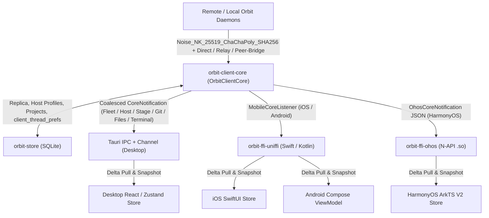

# Orbit Client Architecture & Client Bridge Protocol v2

Desktop, Web PWA, iOS, Android and HarmonyOS share the Rust presentation model in `orbit-client-core`. Native clients use SQLite and the native transport runtime. The browser uses WebAssembly, WebSocket and IndexedDB.

---

## 1. Architectural Principles

1. **Single Authoritative Rust Core**:
   All domain logic, persistence, projection, ranking, and prompt construction live once inside `crates/orbit-client-core` and `crates/orbit-store`:
   - Multi-host connection pool, Noise NK encrypted tunnels (`orbit-crypto`), local replica SQLite storage, and event stream coalescing
   - Unified sidebar tree (`Needs Attention`, `Pinned`, `Projects`, `Launchpad`), git branch enrichment, worktree folding, filter/sort/search, and persisted thread `pinned` + `seen_seq` flags (`client_thread_prefs` in `orbit-store`)
   - Incremental conversation stage projection (`AgentStageDelta` / `TurnLiveSegment` with `Wakeup` & `StepGroup`)
   - Canonical provider fallback model catalogs, retired-slug migration, and effort resolution (`resolve_model_selection`)
   - Platform-filtered slash command catalog (`slash_commands`), fuzzy `@` mention candidate ranking (`rank_mention_candidates`), and prompt/workflow composition (`compose_prompt` including `/plan`, `/goal`, `/review`, `/compact`, `/btw`, plus leading `\/` verbatim escape passthrough)
   - Detached multi-slot VT100 terminal emulation (`terminal_screen_slot`)
   - Conversation rewind (`rewind_agent`), workspace file preview (`read_workspace_file`), and side-question context & streaming (`build_side_question_context`, `ask_side_question`)
   - Pure-Rust native diagram rendering (`diagram.rs`: Mermaid via `mermaid-rs-renderer`, Graphviz DOT via `layout-rs`, XSS-sanitized inline SVG, deterministic SVG `id` namespacing, and a 128-entry LRU cache)
2. **Thin UI Presentation Clients**:
   Native clients own **only** view rendering, platform lifecycle/permissions, native pickers/haptics/keybindings, hardware-accelerated GPU layout transitions, and transient UI state (open sheets, draft text/attachments, local input focus).
3. **Standardized Contract v2 Across All 3 Bridges**:
   - **Desktop**: Tauri IPC commands & typed Channel events (`apps/desktop/src-tauri/src/lib.rs` -> `apps/desktop/src/lib/orbit-ipc.ts`)
   - **iOS & Android**: UniFFI v2 typed records/enums & `MobileCoreListener` (`crates/orbit-ffi-uniffi/src/lib.rs` -> `apps/ios/Generated/*` & `apps/android/.../uniffi/orbit_ffi_uniffi/orbit_ffi_uniffi.kt`)
   - **HarmonyOS** exposes Contract v2 JSON DTOs and `subscribeEvents` through `crates/orbit-ffi-ohos/src/napi/`. ArkTS consumes the declarations in `apps/harmony/entry/src/main/cpp/types/liborbit_ohos/index.d.ts`.

---

## 2. End-to-End Reactive Dataflow



Host detail agent cards expose the optional creation timestamp `created_at_rfc3339` across the three bridges. Desktop uses creation time to associate historical spawn calls with children when the transcript lacks an identity. Activity ordering continues to use `updated_at_rfc3339`.

### Pull-on-Notify Delta Flow

Bridges emit lightweight invalidation notifications (`CoreNotification`) containing only identifiers (`host_id`, `agent_id`, `cwd`, `slot`) rather than broadcasting full snapshot payloads over FFI on every token delta:

1. Daemon pushes streaming events to `OrbitClientCore`.
2. `OrbitClientCore` coalesces high-frequency events (for example, stage token streams and terminal output) and updates its SQLite-backed projections (`orbit-store`).
3. The platform bridge forwards a typed notification (`stage_updated`, `fleet_updated`, `host_updated`, `git_updated`, `files_updated`, `terminal_updated`, etc.).
4. The client store calls the corresponding incremental pull API (`agent_stage_delta`, `fleet_sidebar_request`, `git_review`, `terminal_screen_slot`) using its last applied `revision`, avoiding full-timeline re-serialization.

### Session plan projection

`SessionInsightsView.plan_steps` is an ordered list scoped to the stage's host and agent. Each row carries `id`, `title`, `status`, optional `active_form` and the last contributing timeline sequence `updated_seq`. The five status values are `pending`, `in_progress`, `completed`, `skipped` and `failed`. An omitted list in a full insights payload represents an empty plan. On an incremental delta with `aux_unchanged`, Desktop reuses the previous insights. Earlier timeline pages can supply missing plan events when the projection is recomputed.

Rust replays supported plan tool snapshots and ACP checklist notices. Task creation appends a row and task updates apply by ID, including deletion. A new prompt retains the current plan until a valid replacement or creation arrives. Updates can finish an earlier turn's tasks. Empty snapshots and deletion of the last row clear the shelf. Malformed snapshots and failed or denied tool calls leave the prior plan in place.

Desktop Tauri and HarmonyOS N-API serialize the core stage DTO. Desktop renders the plan above its composer and reconciles the foreground indicator locally. The Swift and Kotlin insights records expose the same ordered plan steps and full-history outline prompts. Empty defaults preserve existing native initializers.

### Full-history outline anchor projection

`TimelineCatchup.outline_prompts` and `SessionInsightsView.outline_prompts` project every non-compaction user prompt `(seq, preview)` across the entire session history independent of tail-first message pagination, using the existing SQLite `(agent_id, seq)` index without loading off-page event payloads. On incremental deltas with `aux_unchanged`, Desktop preserves reference stability and avoids reparsing prompts on streaming token deltas. Desktop's `ChatOutlineRail` displays up to 17 individual prompt ticks before folding earlier prompts into a popover and auto-paginates when jumping to an unloaded historical anchor (`jumpingToSeq`). Older daemons that omit `outline_prompts` fall back cleanly to loaded turns.

---

## 3. Client Bridge Protocol v2 Surface

All Contract v2 request/response DTOs are canonically defined in `crates/orbit-client-core/src/contract.rs` (plus `sidebar.rs`, `stage.rs`, `composer.rs`, `catalog.rs`, `diagram.rs`) and surfaced uniformly across the three bridges:

| Capability | Rust Core (`orbit-client-core`) | Desktop Tauri (`src-tauri`) | UniFFI (`orbit-ffi-uniffi`) | HarmonyOS N-API (`orbit-ffi-ohos`) |
| --- | --- | --- | --- | --- |
| Bridge version & caps | `BridgeInfoView` | `get_bridge_info` | `bridge_info()` | `bridgeInfoJson()` |
| Full-history FTS5 search | `search_messages` / `search_messages_remote` (`WireMessage::SearchMessages`) | `search_messages` / `search_messages_remote` | `search_messages` / `search_messages_remote` | `searchMessagesJson` / `searchMessagesRemoteJson` |
| Sidebar tree + search + prefs | `fleet_sidebar` / `FleetSidebarRequest` | `get_fleet_sidebar` | `fleet_sidebar_request` / `fleet_sidebar` | `fleetSidebarByRequestJsonAsync`, `fleetSidebarByRequestJson`, `fleetSidebarJson` |
| Incremental stage projection | `agent_stage_delta` / `AgentStageDeltaRequest`, `PendingPermissionsSnapshot` | `get_agent_stage` / `get_agent_stage_delta`, `{get,set,delete}_composer_draft` | `agent_stage_delta_request` / `agent_stage_delta` | `agentStageDeltaByRequestJsonAsync`, `agentStageTurnsSliceJson`, `agentStageDeltaByRequestJson`, `agentStageDeltaJson` |
| Delivery lifecycle & stall observability | `AgentMessageDeliveryUpdated` in-place fold, `StageTurnView.latest_activity_ms` / `latest_visible_progress_ms`, `interrupt_agent_and_continue` | `interrupt_agent_and_continue` | `FfiAgentMessageDeliveryStatus`, `interrupt_agent_and_continue` | `interruptAgentAndContinue` |
| Thread seen / unread / pin | `mark_agent_seen`, `mark_agent_unread`, `toggle_pin_agent`, `seed_thread_prefs` | `mark_agent_seen`, `mark_agent_unread`, `toggle_pin_agent`, `seed_thread_prefs` | `mark_agent_seen`, `mark_agent_unread`, `toggle_pin_agent`, `seed_thread_prefs` | `markAgentSeen`, `markAgentUnread`, `togglePinAgent`, `seedThreadPrefsJson` |
| Model catalogs & effort resolution | `fallback_provider_catalogs`, `resolve_model_selection` | `get_fallback_provider_catalogs`, `resolve_model_selection` | `fallback_provider_catalogs`, `resolve_model_selection` | `fallbackProviderCatalogsJson`, `resolveModelSelectionJson` |
| Slash command catalog | `slash_commands(platform, query)` | `get_slash_commands` | `slash_commands(platform, query)` | `slashCommandsJson(platform, query)` |
| `@` Mention fuzzy ranking | `rank_mention_candidates` | `rank_mention_candidates` | `rank_mention_candidates` | `rankMentionCandidatesJson` |
| Prompt & workflow composition | `compose_prompt` (`SlashDirective::Goal` + `\/` escape) | `compose_prompt` + `ComposerGoalShelf` / `GoalDialogs` | `compose_prompt` (`FfiSlashDirective::Goal`) | `composePromptJson` |
| Autonomous Goal runs | `start_goal_run_on_host` (`replace_existing`, `dispatch_initial_prompt`), `update_goal_run_on_host`, `control_goal_run_on_host` | `start_goal_run`, `update_goal_run`, `control_goal_run` (+ `WasmWebBackend` & `WasmHost` parity) | `start_goal`, `update_goal_run`, `control_goal_run` | `startGoalRunJson`, `updateGoalRunJson`, `controlGoalRunJson` |
| Conversation rewind | `rewind_agent` | `rewind_agent` | `rewind_agent_request` / `rewind_agent` | `rewindAgentJson` |
| Workspace file viewer | `read_workspace_file` | `read_workspace_file` | `read_workspace_file_request` / `read_workspace_file` | `readWorkspaceFileJson` |
| Diagram detection & rendering | `detect_diagram_kind`, `render_diagram` (`diagram.rs`) | `render_diagram` | `detect_diagram_kind`, `render_diagram` | `detectDiagramKind`, `renderDiagramJson` |
| Side questions (`/btw`) | `build_side_question_context`, `ask_side_question` | `build_side_question_context`, `ask_side_question` | `build_side_question_context`, `ask_side_question` | `buildSideQuestionContext`, `askSideQuestion` |
| Session creation & prompting | `CreateSessionRequest`, `SendPromptRequest` | `create_agent`, `send_prompt` | `create_session`, `send_prompt_request` | `createSessionJson`, `sendPromptJson` |
| Lifecycle & connectivity | `on_app_foreground`, `on_app_background`, `on_network_changed` | `on_app_foreground`, `on_app_background`, `on_network_changed` | `on_app_foreground`, `on_app_background`, `on_network_changed` | `onAppForeground`, `onAppBackground`, `onNetworkChanged` |
| Host & Agent identity flags | `HostCardView.is_local`, `AgentCardView.has_armed_timers` | Same JSON fields + `isAgentTimerWaiting` | `FfiHostCard.isLocal`, `FfiAgentCard.hasArmedTimers` | Same DTO fields via N-API |
| Global Personal Agent routing | `discover_fleet_router_hosts`, `primary_router_selection` (APP-level) | Wired via Desktop Tauri (`App -> Personal Agent`, host-independent) | `discover_fleet_router_hosts` / `get_router_config` | `discoverFleetRouterHostsJson` / `getRouterConfigJson` |
| Personal Agent briefing & activity log | `personal_agent_briefing` (`personal_agent.rs`, zero-IO), `list_personal_agent_activity` (`WireMessage::ListPersonalAgentActivity`) | `get_personal_agent_briefing`, `list_personal_agent_activity` (+ `WasmWebBackend` & `WasmHost` parity) | Mobile FFI exposure planned | `personalAgentBriefingJson`, `listPersonalAgentActivityJson` |
| SEP-1865 MCP Apps bridge | `read_mcp_resource_async`, `call_artifact_mcp_tool_async` | `read_mcp_resource`, `call_artifact_mcp_tool` | Mobile FFI exposure planned | Mobile FFI exposure planned |
| M3 Security, Audit, Diagnostics & IDE Migration | `get_sandbox_config`, `update_sandbox_config`, `get_audit_chain_status`, `export_audit_chain`, `export_diagnostic_bundle`, `compact_agent_context`, `inspect_external_ide_migration`, `execute_external_ide_migration` | Wired 1:1 in Tauri IPC + `WasmWebBackend` | Mobile FFI exposure planned | Mobile FFI exposure planned |
| M4 Project Memory | `list_project_memories`, `upsert_project_memory`, `confirm_project_memory`, `delete_project_memory`, `recall_project_memory` | Wired 1:1 in Tauri IPC + `WasmWebBackend` (`Instructions & Rules -> Memory`) | Mobile FFI exposure planned | Mobile FFI exposure planned |
| M5 WASM Plugins | `list_plugins`, `install_plugin`, `set_plugin_enabled`, `uninstall_plugin`, `invoke_plugin_op`, `render_plugin_ui` | Wired 1:1 in Tauri IPC + `WasmWebBackend` (`Capabilities -> Plugins` + `PluginUiRenderer`) | Mobile FFI exposure planned | Mobile FFI exposure planned |
| M6 Voice Control | `get_voice_config`, `update_voice_config`, `download_voice_model`, `delete_voice_model`, `transcribe_voice_audio`, `parse_voice_transcript`, `approve_voice_permission`, `synthesize_voice_speech` | Wired 1:1 in Tauri IPC + `WasmWebBackend` (`OmniComposer` morphing circle + `Settings -> Voice`, plus Desktop `list_system_audio_inputs` CoreAudio discovery) | Mobile FFI exposure planned | Mobile FFI exposure planned |

---

Plugin discovery, operation results and UI trees are host-local correlated wire replies. A client renders the typed JSON tree and routes button actions back to the originating host and plugin. The ABI, limits and supported slots are specified in the [plugin SDK](architecture/plugins.md).

### HarmonyOS N-API

In `crates/orbit-ffi-ohos/src/`, `facade/*` groups the host-testable Rust methods by domain. `napi/*` binds them to `OrbitHarmonyCore` and compiles only for HarmonyOS. `events.rs` translates core notifications into JSON for subscribers, and `dto.rs` defines HarmonyOS request payloads.

PR-0 preserved all 227 existing declarations byte-for-byte and added one performance hook, bringing the total to **228 exports**. With `--features perf-hooks`, `debug_replay_stage_deltas_json` is callable from ArkTS as `debugReplayStageDeltasJson(hostId, agentId, framesJson)`. The hook replays recorded stage deltas in memory for that host and agent. Subscribers receive `timeline_changed` and pull each update through the normal stage API. In a standard build the same call returns `perf hooks disabled`.

PR-1 adds ten methods for a total of **238 exports**. The N-API worker pool builds and serializes snapshots for `fleetOverviewJsonAsync`, `hostDetailJsonAsync`, `fleetSidebarByRequestJsonAsync` and `agentStageDeltaByRequestJsonAsync`. The stage request carries the host and agent IDs, both revision cursors, the previous window start and a turn limit (24 on compact screens, 40 on wide screens). Use `agentStageTurnsSliceJson` for earlier loaded turns. When `aux_unchanged` is true, retain the previous pending permissions, questions, plan approval, session turn diffs and insights. When false, replace all five from the delta, including empty values.

`subscribeEvents` coalesces invalidations over 24 ms. If a nonblocking enqueue fails, the subscription retries a single `{"kind":"resync_required"}` marker before delivering further events. On receipt, refresh affected views and reload visible stages with `since_revision = 0` and their turn limit. Ordinary fleet invalidations refresh fleet state independently of stage cursors.

`personalAgentBriefingJson` projects in-memory fleet state. `listPersonalAgentActivityJson` fetches activity from the requested host on a worker. `getComposerDraftJson`, `setComposerDraft` and `deleteComposerDraft` access the local SQLite draft by key. Reads return the original JSON string or null for a missing key. ArkTS stores the versioned draft map under `orbit.drafts.v1` and owns per-scope selection and size limits.

HarmonyOS PR-4 adds a per-session right side panel state machine (`OrbitSidePanelStore`, persisted under Preferences key `orbit.harmony.v2.sidePanel` with 220 ms debounce, LRU 100 scope eviction, and `flushSeq`-guarded retry on sync/async storage failures) paired with global responsive shell widths (`OrbitShellStore`, persisted under `orbit.harmony.v2.sidebar_width_vp` and `orbit.harmony.v2.panel_width_vp`). Panel tab views strictly consume explicit `tab.*` fields with unambiguous JSON-tuple identity keys, blank-only checking across both ArkTS (`nonBlankPath`) and daemon path expansion/authorization (`expand_host_path`, `authorize_*_cwd`, and `git rev-parse --show-toplevel` using `strip_single_line_ending` to remove only a single platform record terminator while preserving trailing spaces and literal `\r`/`\n` in POSIX directory names)—never calling `.trim()` on non-empty `cwd` or file `path` so legal POSIX trailing spaces such as `repo ` or `report.txt ` stay intact end-to-end while preserving registered workspace root authorization boundaries—and exact per-host full normalized cwd comparison (never stripping `/home/<user>` or `/Users/<user>` prefixes; expanding `~` only with an explicit known host home directory): file saves require `writable === true`, send `expected_etag` + `force: false`, validate common target (`host_id`/`cwd`/`path`) and non-negative safe-integer `size_bytes` before branching on `conflict` vs success (requiring non-empty `etag` on success and non-empty `current_etag` + non-negative safe-integer `current_size_bytes` on conflict so malformed or wrong-target receipts never unlock force-overwrite); cross-project file quotes fall back to preserving full source path and loaded text unless `(hostId, fullNormalizedCwd)` is provably identical; `BOARD.md` reads and saves share one ownership verifier requiring any declared `agentId` card to be present in `hostDetail` and refusing to let persisted `workspaceId` break ties among multiple same-cwd workspaces without independent agent ownership proof, unlocking edits only when `workspaceVerified && snapshotLoaded`; scoped Git Review relies directly on native `orbit-client-core` attribution where `fetch_git_diff` tracks in-flight `WireMessage::GitDiffResponse.request_id` tokens alongside a separate per-slot monotonic watermark `latest_dispatched_git_diff_req_seq` keyed by `(canonical_cwd, Option<path>, staged)` (accepting only `req_seq >= latest_dispatched`), physically isolated `git_diffs` (storing `source_req_seq`), full per-cwd directory identity maps `(git_repo_root_by_cwd, git_repo_prefix_by_cwd)` and identity switch epoch `git_cwd_identity_epoch`, unified dispatch-ordered status/mutation sequence tracking (`next_git_status_req_seq`, `pending_git_status_requests`, per-cwd accepted sequence `git_status_seq_by_cwd`, per-cwd valid snapshot revision `git_status_revision_by_cwd`, and `latest_git_status_by_repo_root`), per-slot terminal error revision `last_git_diff_error_revision`, per-cwd identity-switch watermarks (`git_cwd_identity_watermark` / `git_cwd_root_set_seq`), and worktree-level mutation watermarks (`latest_mutation_watermark_by_repo_root`): every `orbit-daemon` status query, diff query (`GetGitDiff`), and repository-level or directory-level mutation handler (Commit, Push, Create PR, Stash, Rebase, Stage, Unstage, ApplyHunk, Discard, ResolveConflict) reports a backward-compatible host-canonicalized physical `repo_root` (resolving POSIX directory symlinks via `resolve_git_scope`) alongside a `repo_prefix` strictly aligned to the caller's requested `cwd` (falling back to `repo_root` with the derived relative subdir prefix or `None` if a mutation deleted the requested subdir, never misreporting `Some("")` for a subdir; only when a legacy daemon omits `repo_root` does the client fall back to deriving a string root from `canonical_cwd` + `repo_prefix`, which is explicitly distinguished from host-canonicalized symlink-resolved physical roots); `fetch_git_status` records a monotonic `next_git_status_req_seq` dispatch order alongside the `origin_identity_epoch` known at dispatch time (correlated by UUID in `pending_git_status_requests`), so pure-read `GitStatusResponse` checks `effective_status_seq >= git_status_seq_by_cwd[cwd]` before mutating any state, dropping out-of-order stale status replies with zero side effects (and cleaning up `pending_git_status_requests` on `RpcError` and disconnect; if a pre-identity `GetGitStatus` fails with `RpcError` while `git_statuses[cwd]` is still empty and an identity is already recorded, core dispatches one bounded post-identity verification `GetGitStatus` with zero retry loop if that retry also fails); if a status query dispatched BEFORE the current directory identity was established (`effective_status_seq <= git_cwd_identity_status_watermark[cwd]` or `origin_identity_epoch < current_identity_epoch`) returns a conflicting `(repo_root, repo_prefix)`—covering BOTH hot rebinds after an established old identity AND cold cwds whose first physical identity was established by a `GitDiffResponse` (e.g. sampled repo A before a symlink switched `A -> B`, arriving after B's diff already established B)—`orbit-client-core` NEVER rebinds back to A and NEVER evicts B's confirmed diffs, instead ensuring one fresh verification `GetGitStatus` is in flight for `cwd`; meanwhile an arriving `GitMutationResult` targeting the originating physical worktree distinguishes receipt arrival from daemon snapshot sampling time as well as in-flight-only vs already-accepted overlapping reads—allocating a fresh higher completion sequence `completion_seq = next_git_status_req_seq += 1` so late pre-write reads are rejected on arrival; whenever an overlapping read in the originating worktree has ALREADY been accepted (`accepted_during_flight_cwds` or `status_seq > mutation_dispatch_seq`) so sampling order against `mutation.status` cannot be proved, `orbit-client-core` settles the write as re-verification pending (`status_reverify_pending = true`, exposed both in OHOS JSON `GitReviewDto.status_reverify_pending` and in UniFFI typed mobile bindings `FfiGitReview.status_reverify_pending` / Swift & Kotlin `statusReverifyPending`), raises `git_status_seq_by_cwd` to `completion_seq` (rejecting any late still-in-flight old reads), coalesces strictly one post-completion `GetGitStatus` per affected `cwd` (suppressing speculative routine `GetGitDiff` refreshes), and **preserves the last-confirmed `git_statuses`, diff body, and `diff_revision` untouched throughout the re-verify wait window** until the authoritative post-completion `GetGitStatus` arrives (at which point `status_reverify_pending` clears, the authoritative snapshot is adopted, and pre-reverify cached diffs are evicted/refreshed; `RpcError`/disconnect clears `status_reverify_pending` so it never strands); when only still-in-flight overlapping reads exist, the write receipt adopts immediately while keeping old UUIDs in `pending_git_status_requests` and coalescing one post-completion `GetGitStatus`, and non-overlapping mutations emit 0 extra status requests (reporting `status_refreshed = false` truthfully if a receipt's status was not adopted); when a non-conflicting accepted `GitStatusResponse` reports a change in the full `(repo_root, repo_prefix)` directory identity (worktree root change, within-worktree subdir prefix switch such as `one` -> `two`, or non-git -> git transition, while same-root same-prefix refreshes preserve confirmed caches, `cwd_identity_epoch`, and `git_cwd_root_set_seq`, updating root-establishment sequence only on initial binding or identity switch), `orbit-client-core` synchronously increments `cwd_identity_epoch`, advances `git_cwd_identity_watermark`/`git_cwd_root_set_seq` and slot watermarks, evicts all old-directory `git_diffs` for that `cwd`, drains old in-flight UUIDs (re-dispatching drained slots that still match the new status), and emits `GitChanged`; on `GitDiffResponse`, reported `repo_root`/`repo_prefix` remain strictly local until identity-watermark, slot-sequence, and full `(repo_root, repo_prefix)` pre-switch guards (checking both `req_seq` and `status_seq_at_dispatch` so a same-refresh diff dispatched after an older-target status is never misclassified as pre-switch) all pass (expired, superseded, or pre-switch replies are dropped without mutating identity maps), whenever a valid `GitDiffResponse` reveals a `(repo_root, repo_prefix)` change on an already-bound `cwd` BEFORE the new directory's `GitStatusResponse` arrives, `orbit-client-core` increments `cwd_identity_epoch`, immediately evicts the old identity's `git_statuses` / `git_status_identity_epoch_by_cwd` so an old repository's clean status never masquerades as the new directory's status, records `git_cwd_identity_status_watermark = next_git_status_req_seq`, and automatically dispatches one target `GetGitStatus` verification query if none is already in flight for the new epoch, and whenever a valid `GitDiffResponse` establishes the FIRST physical `(repo_root, repo_prefix)` on a previously cold `cwd` (`existing_cwd_root` and `existing_cwd_prefix` both `None`), `orbit-client-core` likewise increments `cwd_identity_epoch` and anchors `git_cwd_identity_status_watermark = next_git_status_req_seq` + `git_cwd_root_set_seq`—allowing a matching cold status to be adopted smoothly with 0 extra queries, catching a conflicting old-target status under the conflict guard without reverting, and dispatching 1 `GetGitStatus` automatically if no status query was in flight (without waiting for manual refresh); cross-`cwd` worktree matching NEVER guesses via string prefix containment—matching only when `a_cwd == b_cwd` or when both sides carry recorded roots and `root_a == root_b`, unifying real directories, subdirectories, and POSIX directory symlinks while isolating independent nested repositories (such as `vendor`, even before its first status arrives) and trailing-space siblings (such as `repo `); for cold subdirectories or symlinks whose first reply had not arrived before a mutation, any late pre-mutation `GitDiffResponse` with `req_seq < latest_mutation_watermark_by_repo_root[repo_root]` is rejected (recording identity only when that `cwd` has no established identity yet), compares unified `status_seq` so it updates `git_statuses[cwd]` and advances `status_revision` only when `wt_seq > cwd_status_seq` (never rolling back a newer `GitStatusResponse` already delivered for that `cwd`), and re-dispatches once only if the newer status still matches AND the slot has neither a live in-flight request nor an already-confirmed recovery diff (`source_req_seq >= worktree_watermark`); `dispatch_git_mutation_on_host` records the originating `origin_repo_root`, `origin_identity_epoch`, and `dispatch_seq` at dispatch time, and `GitMutationResult` settles strictly against the originating physical worktree—if `cwd` was rebound to a different physical worktree (e.g. symlink `A -> B`) while the write was in flight, the receipt still resolves the caller's write ack and invalidates/refreshes remaining `A`-mapped siblings and `latest_git_status_by_repo_root[A]`, but NEVER rebinds `cwd` back to `A`, NEVER evicts or overwrites `B`, and suppresses routine post-mutation refresh on `cwd` (same-worktree subdir rebinds preserve the newer `repo_prefix`); for non-rebound mutations, `orbit-client-core` unconditionally evicts every cached `git_diffs` entry in that physical worktree (never keeping stale pre-mutation bodies alive via untracked directory summaries `<dir>/`), raises `latest_dispatched_git_diff_req_seq` and invalidates all pre-mutation in-flight requests across the worktree, refreshes sibling `git_statuses` snapshots under `completion_seq >= prev_seq` (advancing `status_revision` and recording matching `status_identity_epoch`) preserving each sibling's display `cwd`, authoritative `repo_prefix`, and `repo_root`, emits deduplicated `GitChanged` notifications for every affected `cwd`, and deduplicates/re-dispatches invalidated in-flight requests across BOTH `Some(path)` and whole-repo `None` scopes under `(norm_cwd, Option<path>, staged)` with a fresh `request_id`/`req_seq` (exact repo-root-relative path + `staged` mode matching when `repo_prefix` is known, target `staged` mode check for `None` and legacy daemons omitting `repo_prefix`, with 0 re-dispatches on clean or opposite-mode-only status; `dispatch_git_mutation_on_host` skips redundant routine whole-repo refreshes when a live post-mutation request is already in flight for that exact slot; disconnect/session-generation cleanup resets in-flight requests); host-scoped `canonical_git_cwd_key_for_flavor` applies target-host path semantics (`Posix` / `Windows` / `Unknown`), collapsing redundant `/` and `.` segments, expanding `~` only via an explicit per-host `authoritative_home_dir`, and converting `\` to `/` only on explicit Windows paths (`[A-Za-z]:` / `\\` or confirmed Windows hosts)—never converting literal `\` on POSIX or unknown-platform `/` / `//` paths (conservatively keeping unknown-platform `//` distinct from `/` while keeping `\\server\share` <-> `//server/share` idempotent, and collapsing `//` to `/` on confirmed POSIX hosts to match the same inode); `GitReviewView` returns backward-compatible `(staged, diff_revision, diff_in_flight, status_revision, status_identity_epoch, status_reverify_pending, cwd_identity_epoch, last_diff_error_revision, last_diff_error_status_revision)` fields (`diff_revision` strictly advances only on valid `GitDiffResponse` for that exact slot; `status_revision` strictly advances only when that `cwd` accepts a valid `GitStatusSnapshot` alongside its matching `status_identity_epoch` and NEVER on sibling `GitDiffResponse` or `RpcError`; `cwd_identity_epoch` advances only when `(repo_root, repo_prefix)` changes; `diff_in_flight` strictly reports whether a live `req_seq >= latest_dispatched` request that has not yet received either a `GitDiffResponse` or a terminal `RpcError` is currently pending for that exact slot—`WireMessage::RpcError` removes only the failing `request_id`, preserving any newer UUID on the same slot, records `(last_diff_error_revision, last_diff_error_status_revision = current cwd status_revision)` for non-superseded failed requests, and notifies the target `cwd`), `orbit-ffi-ohos`'s `gitReviewJson` accepts an optional 4th `staged` argument (preserving all **238** N-API exports), the legacy 3-argument `git_review` wrapper selects whichever mode slot for that exact `(canonical_cwd, path)` holds the highest valid `diff_revision` (unaffected by requests for other files in the same repo) while explicit 4th `staged` reads the exact target slot; `orbit-daemon/src/git.rs` uses `git status --porcelain=v2 -z --branch` (NUL-delimited unquoted literal paths even under `core.quotePath=true`, properly consuming rename/copy `origPath` records and reporting backward-compatible `repo_prefix`/`repo_root`), `git --literal-pathspecs` + `ls-files --others --exclude-standard -z`, and Git-compatible C-quoting on synthesized untracked diff headers containing tabs/quotes/control chars; `orbit-daemon/src/git_write.rs` runs `stage_files` and `unstage_files` with `--literal-pathspecs`, and `unstage_files` inspects `git --literal-pathspecs diff --cached --name-status -z` (honoring the repository's `diff.renames` config without forcing `-M` and propagating command errors) so unstaging a staged rename (`R*` only—never copies `C*` or ordinary entries) atomically validates both paths before mutating the index, resetting the pair in one `reset HEAD` call when both lie within `cwd` and aborting with `InvalidInput` (leaving the intact `R*` untouched) when a cross-directory rename source falls outside `cwd`; `orbit-client-core/src/render.rs` parses Git unified diff headers (`rename to`/`copy to`/`rename from`/`copy from`, `\t` separators, and C-quoted escapes without `.trim()`), and `OrbitScopedGitTabView` row actions (Stage/Unstage/line quotes) pass the parsed literal `row.filePath` via `resolveGitDiffRowActionPath` (never substituting a directory/pathspec `selected_path` based on filtered row count, falling back only when `row.filePath` is empty), preserving `report.txt ` vs `report.txt`, `part b/tail` vs `tail`, `budget\t2026.txt`, and workspace `None` vs literal `'__all__'` end-to-end; ArkTS keeps only a lightweight native revision tracker (`gitDiffModeTrackers`, bounded to LRU 16 with a 1500 ms timeout to `unverified` and `OrbitScopedGitTabView`'s `diffModeState !== 'confirmed'` empty guard), performing zero synchronous `gitReviewJson` reads and zero fetches whenever `Review` is hidden (including when only `Files` is visible, which refreshes only workspace files), reading only the active visible Review tab's exact `(path, staged)` on `git_changed` and distinguishing dispatch, sampling, and UI observation points via three unambiguous algebraic rules: (A) when `cwd_identity_epoch` advances, regardless of whether the visible slot was previously `confirmed`, already-cleared `unverified`, or `idle`, drop cached payload immediately—if matching status for the new identity has not yet arrived (`status === null` or `status_identity_epoch !== cwd_identity_epoch`, e.g. a whole-repo diff revealed the switch before the new directory's status arrived), keep `lastObservedIdentityEpoch` unadvanced in pending state, and once matching status arrives judge clean (0 fetches) vs dirty (adopt in-flight or 1 exact fetch); (B) when `last_diff_error_revision` advances, unconditionally arm `pendingErrorRecovery = true` anchored at native `last_diff_error_status_revision` (captured at the exact instant the error settled in Rust—decoupled from the 1.5s UI timer, prior non-zero `diff_revision`, and frame coalescing), drop failed `loading` to `unverified`, and fall through into Rule C in the SAME coalesced frame; (C) consume `pendingErrorRecovery` IF AND ONLY IF `snap.status_revision > errorObservedStatusRevision` (so error + post-error status coalesced in the same frame immediately trigger 1 recovery fetch, pre-error status + error in the same frame wait for the next status, and sibling-file `GitDiffResponse` events never increment `status_revision` and never consume the single recovery opportunity), adopting in-flight or issuing 1 exact fetch if dirty (or clearing with 0 fetches if clean); (D) for an `unverified`/`idle` visible slot with `diff_revision === 0` and no pending error recovery, whenever a strictly newer matching-identity `GitStatusSnapshot` advances `status_revision` and shows the slot dirty (e.g. a coalesced post-completion `GetGitStatus` recheck restoring a post-write edit after a delayed mutation ack), adopt any live in-flight request or issue 1 exact fetch (while clean or non-advancing status events emit 0 fetches), while preserving non-error eviction/loading adoption and bounded single re-fetch; scoped mutation callbacks in `OrbitHarmonyStore` (`syncPostMutationGitReview`) and `OrbitScopedGitTabView.runScopedWrite` (`reloadScopedGit(true, false, true)`) prioritize preserving and returning any matching-slot `(identity, path, staged)` positive-revision confirmed snapshot (`diff_revision > 0`) without clearing component cache or arming a wipe timer even when a concurrent same-slot `diff_in_flight === true` coexists with `status_reverify_pending === true` (keeping confirmed diff lines continuously rendered across the re-verify wait window while reusing the in-flight request with 0 duplicate fetches and smoothly updating once re-verify and the new diff arrive), fall back to adopting the single core post-mutation `diff_in_flight` request when `diff_revision === 0` (emitting 0 duplicate requests while keeping explicit manual refresh at `reuseInFlight = false`), immediately releasing old diff payload caches on tab close/unmount/same-kind takeover, clearing trackers on host removal, and guarding commit/AI-message/PR drafts by independent edit versions; all five Automations creation forms maintain per-target/kind edit versions plus token-checked in-flight submission locks lifted into `OrbitHarmonyStore` so locks survive tab unmount/remount and unlock strictly by token; Briefing tabs project missions and deduplicated counts strictly to `(hostId, agentId)`; agent and cross-host subagent routing distinguishes missing agent cards (`missingAgentCard`) from verified root cards across `selectAgent` (exempting only locally created optimistic sessions recorded by `createSessionJson`), Crew, and Peer entries, allocates a unified `navigationSeq` across explicit user navigation entries (explicit user navigation cancels stale queued/in-flight deep-links, while automatic default first-host/first-agent initialization never bumps `navigationSeq`), distinguishes a same-host `hostDetail` request superseded by a newer generation (`host_changed`) from host removal or real failure via `OrbitFleetStore.awaitLatestHostDetailAsync` (following/re-reading the latest generation while suppressing default `agents[0]` auto-selection until the explicit target resolves or genuinely fails), hydrates missing details/ancestor hosts asynchronously, and fails closed preserving current selection on missing card, removal, or hop-limit exhaustion while targeting read/steer/archive to the child's actual `host_id` and direct parent chain (with per-host `hostDetailRevisionByHost` archive-hide invalidation and incremental `@ObservedV2` turn/segment rendering covering both `seg.item` and `seg.items`). Event invalidation and `resync_required` target the currently visible panel tab's `(hostId, agentId, cwd, terminalSlot, gitStaged)`, `/btw` side questions canonicalize and deduplicate all legacy/stale-draft `side_question` tabs per scope across hydration, `promoteDraftScope`, and `remapOptimisticScopes` using the same canonical-metadata priority rule for both open `tabs` and `closedTabs` (preserving LIFO order and non-null `agentId`, migrating `activeTabId`/`unseenTabIds`, and revoking `requestToken` on `dropScope`/host removal), and `AdaptiveWorkspace` + `OrbitSidePanelContainer` enforce a single authoritative immutable-`presentationId` lifecycle exit path per keyed presentation instance (`ForEach`-keyed `OrbitModalContentRouter` for standard sheet & Lightbox and `OrbitCompactSheetPanelContent` for compact panel, removing secondary mutable `bindSheet.onDisappear` callbacks, tracking completed IDs with an O(1) monotonic watermark + bounded window, directly replacing unmounted sheets before first render, and isolating Lightbox swaps/closes from newer sheets) over a single standard `bindSheet` plus a full-screen edge-to-edge Lightbox host for `image_viewer` and `diagram_viewer` (actual device/emulator fold geometry, IME, hardware keyboard, and sheet transition timing remain device-side B1 verification boundaries).

`bash scripts/check-ohos-dts-sync.sh --print-count` scans `lib.rs` first, then `napi/**/*.rs` in lexical path order. It rejects duplicate method names on the same class and compares the generated declarations with the checked-in `index.d.ts`. For the JSON payload contract, `node scripts/check-harmony-dto-contract.mjs` compares the top-level keys of Rust-generated fixtures in `apps/harmony/contract/fixtures/` with ArkTS interfaces in `model/OrbitTypes.ets` and `model/dto/*.ets`. Missing and extra fields both fail the check.

## 4. Thread Preferences Persistence & Legacy Migration

Thread metadata (`seen_seq`, `is_pinned`, `pinned_order`, `updated_at_ms`) is persisted in the SQLite table `client_thread_prefs` inside `crates/orbit-store/src/lib.rs`, with cascade cleanup when a replica agent or host is removed:

- **One-Time Seed Migration**: Existing clients previously storing pins/seen markers in local UI storage (Desktop `localStorage`, iOS `UserDefaults`, Android `SharedPreferences`, HarmonyOS `OrbitPreferencesStore`) perform a one-time idempotent migration on launch by sending their legacy entries to `seed_thread_prefs`, then setting a local migration flag so SQLite remains the sole source of truth afterward.
- **SQLite Composer Draft Fallback Mirror**: Desktop `draft-persistence.ts` mirrors `orbit.drafts.v1` into SQLite table `composer_drafts` (`get/set/delete_composer_draft` Tauri commands in `orbit-store`/`orbit-client-core`) so cold restarts recover unsaved drafts even across WebView storage eviction, while `orbit-store` reconciles `replaced_optimistic_agents` (`opt_*` -> `ag_*`) atomically across `selectedAgentId`, `stages`, and drafts.
- **Worktree Unread Propagation & Wakeup Dividers**: Both sidebar unread status and `TurnLiveSegment::Wakeup` timeline separators are derived consistently inside `orbit-client-core` and rendered across all four UIs (including explicit **Mark Unread** / **Pin** actions).

---

## 5. Native binding coverage

| Feature / Domain | Rust Core (`orbit-client-core`) | Desktop (React/TS) | iOS (SwiftUI) | Android (Compose) | HarmonyOS (ArkTS V2) |
| --- | --- | --- | --- | --- | --- |
| Sidebar grouping, filter, sort, search | Computes `FleetSidebarView` | Renders `sidebarView` | Renders `sidebarView` | Renders `sidebarView` | Renders `sidebarView` |
| Thread pin & unread (`client_thread_prefs`) | SQLite CRUD + computation | `togglePinAgent` / `markAgentUnread` | `togglePinAgent` / `markAgentUnread` | `togglePinAgent` / `markAgentUnread` | `togglePinThread` / `markAgentUnread` |
| Provider fallback catalogs & slug cleanup | `catalog.rs` + `resolve_model_selection` | Thin store consumer | Thin store consumer | Thin store consumer | Thin store consumer |
| Slash commands & `@` mention ranking | `slash_commands` + `rank_mention_candidates` | Consumes Rust results | Consumes Rust results | Consumes Rust results | Consumes Rust results |
| Prompt `<WORKFLOW_INSTRUCTION>` & `/btw` | `compose_prompt` | Consumes `ComposedPrompt` | Consumes `ComposedPrompt` | Consumes `ComposedPrompt` | Consumes `ComposedPromptDto` |
| Stage projection & coalescing | `stage.rs` (`agent_stage_delta`, delivery status fold & progress timestamps) | Applies `changed_turns` delta + live stall/queue banner | Applies `changed_turns` delta + delivery pills | Applies `changed_turns` delta | Applies `changed_turns` delta |
| Side questions (`/btw`) | `ask_side_question` stream | `SideQuestionPanel` | Contract v2 wired in store | Contract v2 wired in store | Scoped `side_question` panel + `source: 'auto'` unread |
| Native diagrams (Mermaid / DOT / SVG) | `diagram.rs` (`mermaid-rs-renderer` + `layout-rs` + SVG sanitizer + LRU) | `DiagramBlock` + GPU lightbox | `DiagramBlockView` (`WKWebView`) + `fullScreenCover` | `DiagramBlockSurface` (`WebView`) + `Dialog` | `DiagramBlockView` (`@kit.ArkWeb`) + full-screen Lightbox |
| GPU Layout Animations | N/A | GPU `translate3d` push/pull shell | Native SwiftUI Navigation/Sheet | Compose AnimatedVisibility | ArkUI Sheet / Sidebar Motion |

---

## Mobile writes, approvals and automation

Swift and Kotlin use generated UniFFI methods. HarmonyOS exposes the same host-scoped operations through `OrbitHarmonyCore`. The N-API worker pool returns promises for network requests. Git operations retain the daemon's expected OID, conflict hash and rebase step checks. Permission batches pass agent and request IDs together for server-side verification. Remote search returns host success/failure counts. Session usage totals are scoped to one agent on one host over the retained daemon ledger.

The SQLite `client_pending_outbox` stores durable wire commands in host-scoped FIFO order. A full queue rejects the next write at 100 entries and surfaces a host error. The client retains the original request ID until a local transport write succeeds. This gives at-least-once delivery across a crash between transport completion and row deletion. Terminal resize, input, heartbeats and ephemeral subscriptions have separate live-session lifetimes.

Pass a platform-protected 32-byte key through `OrbitMobileCore.newWithMasterKey` (bytes) or `OrbitHarmonyCore.newWithMasterKey` (standard Base64). Harmony also exports the same constructor as `OhosOrbitCore.newWithMasterKey`. The platform owns key creation, protection and recovery. Use the same key across opens of the same database. See [Cloud Sync](cloud-sync.md) for migration and dirty-state semantics.

## 6. Binding Synchronization & Verification Workflow

Use `bash scripts/sync-bindings.sh --check` to generate Swift and Kotlin bindings in a temporary directory and compare them with the checked-in bindings. A difference on either platform fails the check. When FFI types change, regenerate the affected bindings before running the workspace checks.

```bash
# 1. Regenerate iOS (Swift) and Android (Kotlin) UniFFI bindings
bash scripts/sync-bindings.sh
bash scripts/check-ohos-dts-sync.sh --write
bash scripts/check-ohos-dts-sync.sh

# 2. Rust formatting, strict Clippy, and workspace unit/integration tests
cargo fmt --all -- --check
cargo clippy --workspace --all-targets -- -D warnings
cargo test --workspace

# 3. Desktop Rust backend + TypeScript + Vite bundle
cargo clippy --manifest-path apps/desktop/src-tauri/Cargo.toml --all-targets -- -D warnings
(cd apps/desktop && npx tsc --noEmit && npm run build)

# 4. iOS Swift parse verification against generated UniFFI bindings
swiftc -parse apps/ios/Generated/orbit_ffi_uniffi.swift $(find apps/ios/Sources -name '*.swift' | sort)
```

## Host-scoped voice control

The shared Rust entry points on `OrbitAppCore` take an explicit `host_id` and correlate each reply by request UUID. Settings and model mutations (`get_voice_config`, `update_voice_config`, `download_voice_model`, `delete_voice_model`) return `VoiceConfigState`. Clients can use the verified inventory and host executable capabilities to display available backends.

`transcribe_voice_audio` takes base64 mono PCM16, its sample rate, an optional locale and an optional agent ID. The result includes transcript text, input duration, backend and parsed intent. An empty transcript with `system_client_fallback` requests native/Web Speech recognition. Submit the resulting text through `parse_voice_transcript` with the same host and agent. Parsing has no agent side effects. Language selection accepts `auto`, `en`, `zh` and `ja`. Examples include “read last reply”, “切换到 Build” and “キューの状態”. Explicit approval phrases include “confirm approval of request R1”, “确认批准请求 R1” and “リクエスト R1 の承認を確認”. Request IDs retain their case.

For permission approvals, display the visual permission UI on `requires_visual_confirmation`. On `requires_spoken_confirmation`, collect an explicit confirmation for the same request. Route confirmed approvals through `approve_voice_permission`; it checks the live request again before a one-time dispatch. An absent, unassessed, high-risk, human-only or plan request yields visual confirmation.

`synthesize_voice_speech` returns a validated WAV, MIME type, duration and backend. Its structured error code `voice_client_tts_required` requests client synthesis. The separate `voice_tts_disabled` code respects the host's explicit preference for silence. Clients may use `auto_speak_responses` when selecting assistant replies for speech.

## 7. WebAssembly and browser transport

`orbit-client-wasm` links the renderer, diagram, math, stage, sidebar, catalog, composer and export modules from `orbit-client-core` with its native feature disabled. Browser Noise and cloud vault operations call `orbit-crypto`. A pure Rust zstd implementation preserves the encrypted Gist vault format. The browser keeps one session and one timeline replica per paired host.

`apps/web` loads the generated bindings and installs `WasmWebBackend` before mounting the Desktop React workspace. Tauri selects `TauriIpcBackend` and retains native IPC channels and binary arguments. Browser sessions try the direct WebSocket routes and then the configured WebSocket relay. The first authenticated Hello advertises `supports_zstd: false`. Welcome must match the pairing offer's host ID and static public key. Inside Noise, wire JSON uses discriminator `0x02`, compressed wire JSON uses `0x00`, and terminal frames use `0x01`. Older Hellos default to compressed output. Relay tunnel forwarding operates on ciphertext for both encodings.

Pair with the URI or QR image printed by `orbit pair`. The browser stores paired profiles and bounded host snapshots in IndexedDB under a non-extractable AES-GCM key. Reopening the shell hydrates host metadata offline and refreshes it on connection. Live timelines are scoped to host and agent. Native SSH, external editors and OS integration require the desktop application.

Install the Rust `wasm32-unknown-unknown` target, then run `npm ci && npm run build` in `apps/web`. The build generates version-matched wasm-bindgen glue and a service worker precache for that release's shell and WASM. Serve `dist` from a trusted HTTPS origin or run `orbit daemon --serve-web apps/web/dist` on loopback. The foreground relay accepts the same option. Static hosting defaults to off. An HTTPS page needs browser-permitted WebSocket endpoints, normally `wss://`. The daemon admits its hosted same-origin PWA on the encrypted endpoint. The existing direct RPC origin and bearer checks still apply to native RPC endpoints.

### Editor predictions and pull request reviews

The desktop commands `get_fim_config`, `update_fim_config`, `predict_inline_edit` and `run_pr_patrol` take a host ID. Prediction takes an `input: InlineEditInput` object and returns the completion, source, request ID and elapsed milliseconds. Patrol accepts `cwd`, optional base/head refs and PR number, and an explicit posting flag. Both use correlated replies on the selected host session. See [the daemon contract](architecture/daemon-shim-providers.md).
