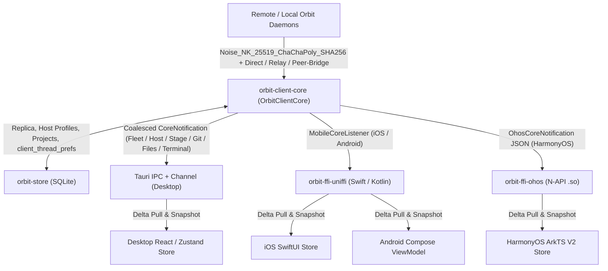

# Orbit Client Architecture & Client Bridge Protocol v2

Desktop, Web PWA, iOS, Android and HarmonyOS share the Rust presentation model in `orbit-client-core`. Native clients use SQLite and the native transport runtime. The browser uses WebAssembly, WebSocket and IndexedDB.

---

## 1. Architectural Principles

1. **Single Authoritative Rust Core**:
   All domain logic, persistence, projection, ranking, and prompt construction live once inside `crates/orbit-client-core` and `crates/orbit-store`:
   - Multi-host connection pool, Noise NK encrypted tunnels (`orbit-crypto`), local replica SQLite storage, and event stream coalescing
   - Unified sidebar tree (`Needs Attention`, `Pinned`, `Projects`, `Launchpad`), git branch enrichment, worktree folding, filter/sort/search, and persisted thread `pinned` + `seen_seq` flags (`client_thread_prefs` in `orbit-store`)
   - Incremental conversation stage projection (`AgentStageDelta` / `TurnLiveSegment` with `Wakeup` & `StepGroup`)
   - Canonical provider fallback model catalogs, retired-slug migration, and effort resolution (`resolve_model_selection`)
   - Platform-filtered slash command catalog (`slash_commands`), fuzzy `@` mention candidate ranking (`rank_mention_candidates`), and prompt/workflow composition (`compose_prompt` including `/plan`, `/goal`, `/review`, `/compact`, `/btw`, plus leading `\/` verbatim escape passthrough)
   - Detached multi-slot VT100 terminal emulation (`terminal_screen_slot`)
   - Conversation rewind (`rewind_agent`), workspace file preview (`read_workspace_file`), and side-question context & streaming (`build_side_question_context`, `ask_side_question`)
   - Pure-Rust native diagram rendering (`diagram.rs`: Mermaid via `mermaid-rs-renderer`, Graphviz DOT via `layout-rs`, XSS-sanitized inline SVG, deterministic SVG `id` namespacing, and a 128-entry LRU cache)
2. **Thin UI Presentation Clients**:
   Native clients own **only** view rendering, platform lifecycle/permissions, native pickers/haptics/keybindings, hardware-accelerated GPU layout transitions, and transient UI state (open sheets, draft text/attachments, local input focus).
3. **Standardized Contract v2 Across All 3 Bridges**:
   - **Desktop**: Tauri IPC commands & typed Channel events (`apps/desktop/src-tauri/src/lib.rs` -> `apps/desktop/src/lib/orbit-ipc.ts`)
   - **iOS & Android**: UniFFI v2 typed records/enums & `MobileCoreListener` (`crates/orbit-ffi-uniffi/src/lib.rs` -> `apps/ios/Generated/*` & `apps/android/.../uniffi/orbit_ffi_uniffi/orbit_ffi_uniffi.kt`)
   - **HarmonyOS** exposes Contract v2 JSON DTOs and `subscribeEvents` through `crates/orbit-ffi-ohos/src/napi/`. ArkTS consumes the declarations in `apps/harmony/entry/src/main/cpp/types/liborbit_ohos/index.d.ts`.

---

## 2. End-to-End Reactive Dataflow



Host detail agent cards expose the optional creation timestamp `created_at_rfc3339` across the three bridges. Desktop uses creation time to associate historical spawn calls with children when the transcript lacks an identity. Activity ordering continues to use `updated_at_rfc3339`.

### Pull-on-Notify Delta Flow

Bridges emit lightweight invalidation notifications (`CoreNotification`) containing only identifiers (`host_id`, `agent_id`, `cwd`, `slot`) rather than broadcasting full snapshot payloads over FFI on every token delta:

1. Daemon pushes streaming events to `OrbitClientCore`.
2. `OrbitClientCore` coalesces high-frequency events (for example, stage token streams and terminal output) and updates its SQLite-backed projections (`orbit-store`).
3. The platform bridge forwards a typed notification (`stage_updated`, `fleet_updated`, `host_updated`, `git_updated`, `files_updated`, `terminal_updated`, etc.).
4. The client store calls the corresponding incremental pull API (`agent_stage_delta`, `fleet_sidebar_request`, `git_review`, `terminal_screen_slot`) using its last applied `revision`, avoiding full-timeline re-serialization.

### Session plan projection

`SessionInsightsView.plan_steps` is an ordered list scoped to the stage's host and agent. Each row carries `id`, `title`, `status`, optional `active_form` and the last contributing timeline sequence `updated_seq`. The five status values are `pending`, `in_progress`, `completed`, `skipped` and `failed`. An omitted list in a full insights payload represents an empty plan. On an incremental delta with `aux_unchanged`, Desktop reuses the previous insights. Earlier timeline pages can supply missing plan events when the projection is recomputed.

Rust replays supported plan tool snapshots and ACP checklist notices. Task creation appends a row and task updates apply by ID, including deletion. A new prompt retains the current plan until a valid replacement or creation arrives. Updates can finish an earlier turn's tasks. Empty snapshots and deletion of the last row clear the shelf. Malformed snapshots and failed or denied tool calls leave the prior plan in place.

Desktop Tauri and HarmonyOS N-API serialize the core stage DTO. Desktop renders the plan above its composer and reconciles the foreground indicator locally. The Swift and Kotlin insights records expose the same ordered plan steps and full-history outline prompts. Empty defaults preserve existing native initializers.

### Full-history outline anchor projection

`TimelineCatchup.outline_prompts` and `SessionInsightsView.outline_prompts` project every non-compaction user prompt `(seq, preview)` across the entire session history independent of tail-first message pagination, using the existing SQLite `(agent_id, seq)` index without loading off-page event payloads. On incremental deltas with `aux_unchanged`, Desktop preserves reference stability and avoids reparsing prompts on streaming token deltas. Desktop's `ChatOutlineRail` displays up to 17 individual prompt ticks before folding earlier prompts into a popover and auto-paginates when jumping to an unloaded historical anchor (`jumpingToSeq`). Older daemons that omit `outline_prompts` fall back cleanly to loaded turns.

---

## 3. Client Bridge Protocol v2 Surface

All Contract v2 request/response DTOs are canonically defined in `crates/orbit-client-core/src/contract.rs` (plus `sidebar.rs`, `stage.rs`, `composer.rs`, `catalog.rs`, `diagram.rs`) and surfaced uniformly across the three bridges:

| Capability | Rust Core (`orbit-client-core`) | Desktop Tauri (`src-tauri`) | UniFFI (`orbit-ffi-uniffi`) | HarmonyOS N-API (`orbit-ffi-ohos`) |
| --- | --- | --- | --- | --- |
| Bridge version & caps | `BridgeInfoView` | `get_bridge_info` | `bridge_info()` | `bridgeInfoJson()` |
| Full-history FTS5 search | `search_messages` / `search_messages_remote` (`WireMessage::SearchMessages`) | `search_messages` / `search_messages_remote` | `search_messages` / `search_messages_remote` | `searchMessagesJson` / `searchMessagesRemoteJson` |
| Sidebar tree + search + prefs | `fleet_sidebar` / `FleetSidebarRequest` | `get_fleet_sidebar` | `fleet_sidebar_request` / `fleet_sidebar` | `fleetSidebarByRequestJson` / `fleetSidebarJson` |
| Incremental stage projection | `agent_stage_delta` / `AgentStageDeltaRequest`, `PendingPermissionsSnapshot` | `get_agent_stage` / `get_agent_stage_delta`, `{get,set,delete}_composer_draft` | `agent_stage_delta_request` / `agent_stage_delta` | `agentStageDeltaByRequestJson` / `agentStageDeltaJson` |
| Delivery lifecycle & stall observability | `AgentMessageDeliveryUpdated` in-place fold, `StageTurnView.latest_activity_ms` / `latest_visible_progress_ms`, `interrupt_agent_and_continue` | `interrupt_agent_and_continue` | `FfiAgentMessageDeliveryStatus`, `interrupt_agent_and_continue` | `interruptAgentAndContinue` |
| Thread seen / unread / pin | `mark_agent_seen`, `mark_agent_unread`, `toggle_pin_agent`, `seed_thread_prefs` | `mark_agent_seen`, `mark_agent_unread`, `toggle_pin_agent`, `seed_thread_prefs` | `mark_agent_seen`, `mark_agent_unread`, `toggle_pin_agent`, `seed_thread_prefs` | `markAgentSeen`, `markAgentUnread`, `togglePinAgent`, `seedThreadPrefsJson` |
| Model catalogs & effort resolution | `fallback_provider_catalogs`, `resolve_model_selection` | `get_fallback_provider_catalogs`, `resolve_model_selection` | `fallback_provider_catalogs`, `resolve_model_selection` | `fallbackProviderCatalogsJson`, `resolveModelSelectionJson` |
| Slash command catalog | `slash_commands(platform, query)` | `get_slash_commands` | `slash_commands(platform, query)` | `slashCommandsJson(platform, query)` |
| `@` Mention fuzzy ranking | `rank_mention_candidates` | `rank_mention_candidates` | `rank_mention_candidates` | `rankMentionCandidatesJson` |
| Prompt & workflow composition | `compose_prompt` (`SlashDirective::Goal` + `\/` escape) | `compose_prompt` + `ComposerGoalShelf` / `GoalDialogs` | `compose_prompt` (`FfiSlashDirective::Goal`) | `composePromptJson` |
| Autonomous Goal runs | `start_goal_run_on_host` (`replace_existing`, `dispatch_initial_prompt`), `update_goal_run_on_host`, `control_goal_run_on_host` | `start_goal_run`, `update_goal_run`, `control_goal_run` (+ `WasmWebBackend` & `WasmHost` parity) | `start_goal`, `update_goal_run`, `control_goal_run` | `startGoalRunJson`, `updateGoalRunJson`, `controlGoalRunJson` |
| Conversation rewind | `rewind_agent` | `rewind_agent` | `rewind_agent_request` / `rewind_agent` | `rewindAgentJson` |
| Workspace file viewer | `read_workspace_file` | `read_workspace_file` | `read_workspace_file_request` / `read_workspace_file` | `readWorkspaceFileJson` |
| Diagram detection & rendering | `detect_diagram_kind`, `render_diagram` (`diagram.rs`) | `render_diagram` | `detect_diagram_kind`, `render_diagram` | `detectDiagramKind`, `renderDiagramJson` |
| Side questions (`/btw`) | `build_side_question_context`, `ask_side_question` | `build_side_question_context`, `ask_side_question` | `build_side_question_context`, `ask_side_question` | `buildSideQuestionContext`, `askSideQuestion` |
| Session creation & prompting | `CreateSessionRequest`, `SendPromptRequest` | `create_agent`, `send_prompt` | `create_session`, `send_prompt_request` | `createSessionJson`, `sendPromptJson` |
| Lifecycle & connectivity | `on_app_foreground`, `on_app_background`, `on_network_changed` | `on_app_foreground`, `on_app_background`, `on_network_changed` | `on_app_foreground`, `on_app_background`, `on_network_changed` | `onAppForeground`, `onAppBackground`, `onNetworkChanged` |
| Host & Agent identity flags | `HostCardView.is_local`, `AgentCardView.has_armed_timers` | Same JSON fields + `isAgentTimerWaiting` | `FfiHostCard.isLocal`, `FfiAgentCard.hasArmedTimers` | Same DTO fields via N-API |
| Global Personal Agent routing | `discover_fleet_router_hosts`, `primary_router_selection` (APP-level) | Wired via Desktop Tauri (`App -> Personal Agent`, host-independent) | `discover_fleet_router_hosts` / `get_router_config` | `discoverFleetRouterHostsJson` / `getRouterConfigJson` |
| Personal Agent briefing & activity log | `personal_agent_briefing` (`personal_agent.rs`, zero-IO), `list_personal_agent_activity` (`WireMessage::ListPersonalAgentActivity`) | `get_personal_agent_briefing`, `list_personal_agent_activity` (+ `WasmWebBackend` & `WasmHost` parity) | Mobile FFI exposure planned | Mobile FFI exposure planned |
| SEP-1865 MCP Apps bridge | `read_mcp_resource_async`, `call_artifact_mcp_tool_async` | `read_mcp_resource`, `call_artifact_mcp_tool` | Mobile FFI exposure planned | Mobile FFI exposure planned |
| M3 Security, Audit, Diagnostics & IDE Migration | `get_sandbox_config`, `update_sandbox_config`, `get_audit_chain_status`, `export_audit_chain`, `export_diagnostic_bundle`, `compact_agent_context`, `inspect_external_ide_migration`, `execute_external_ide_migration` | Wired 1:1 in Tauri IPC + `WasmWebBackend` | Mobile FFI exposure planned | Mobile FFI exposure planned |
| M4 Project Memory | `list_project_memories`, `upsert_project_memory`, `confirm_project_memory`, `delete_project_memory`, `recall_project_memory` | Wired 1:1 in Tauri IPC + `WasmWebBackend` (`Instructions & Rules -> Memory`) | Mobile FFI exposure planned | Mobile FFI exposure planned |
| M5 WASM Plugins | `list_plugins`, `install_plugin`, `set_plugin_enabled`, `uninstall_plugin`, `invoke_plugin_op`, `render_plugin_ui` | Wired 1:1 in Tauri IPC + `WasmWebBackend` (`Capabilities -> Plugins` + `PluginUiRenderer`) | Mobile FFI exposure planned | Mobile FFI exposure planned |
| M6 Voice Control | `get_voice_config`, `update_voice_config`, `download_voice_model`, `delete_voice_model`, `transcribe_voice_audio`, `parse_voice_transcript`, `approve_voice_permission`, `synthesize_voice_speech` | Wired 1:1 in Tauri IPC + `WasmWebBackend` (`OmniComposer` morphing circle + `Settings -> Voice`, plus Desktop `list_system_audio_inputs` CoreAudio discovery) | Mobile FFI exposure planned | Mobile FFI exposure planned |

---

Plugin discovery, operation results and UI trees are host-local correlated wire replies. A client renders the typed JSON tree and routes button actions back to the originating host and plugin. The ABI, limits and supported slots are specified in the [plugin SDK](architecture/plugins.md).

### HarmonyOS N-API

In `crates/orbit-ffi-ohos/src/`, `facade/*` groups the host-testable Rust methods by domain. `napi/*` binds them to `OrbitHarmonyCore` and compiles only for HarmonyOS. `events.rs` translates core notifications into JSON for subscribers, and `dto.rs` defines HarmonyOS request payloads.

PR-0 preserved all 227 existing declarations byte-for-byte and added one performance hook, bringing the total to **228 exports**. With `--features perf-hooks`, `debug_replay_stage_deltas_json` is callable from ArkTS as `debugReplayStageDeltasJson(hostId, agentId, framesJson)`. The hook replays recorded stage deltas in memory for that host and agent. Subscribers receive `timeline_changed` and pull each update through the normal stage API. In a standard build the same call returns `perf hooks disabled`.

`bash scripts/check-ohos-dts-sync.sh --print-count` scans `lib.rs` first, then `napi/**/*.rs` in lexical path order. It rejects duplicate method names on the same class and compares the generated declarations with the checked-in `index.d.ts`. For the JSON payload contract, `node scripts/check-harmony-dto-contract.mjs` compares the top-level keys of Rust-generated fixtures in `apps/harmony/contract/fixtures/` with ArkTS interfaces in `model/OrbitTypes.ets` and `model/dto/*.ets`. Missing and extra fields both fail the check.

## 4. Thread Preferences Persistence & Legacy Migration

Thread metadata (`seen_seq`, `is_pinned`, `pinned_order`, `updated_at_ms`) is persisted in the SQLite table `client_thread_prefs` inside `crates/orbit-store/src/lib.rs`, with cascade cleanup when a replica agent or host is removed:

- **One-Time Seed Migration**: Existing clients previously storing pins/seen markers in local UI storage (Desktop `localStorage`, iOS `UserDefaults`, Android `SharedPreferences`, HarmonyOS `OrbitPreferencesStore`) perform a one-time idempotent migration on launch by sending their legacy entries to `seed_thread_prefs`, then setting a local migration flag so SQLite remains the sole source of truth afterward.
- **SQLite Composer Draft Fallback Mirror**: Desktop `draft-persistence.ts` mirrors `orbit.drafts.v1` into SQLite table `composer_drafts` (`get/set/delete_composer_draft` Tauri commands in `orbit-store`/`orbit-client-core`) so cold restarts recover unsaved drafts even across WebView storage eviction, while `orbit-store` reconciles `replaced_optimistic_agents` (`opt_*` -> `ag_*`) atomically across `selectedAgentId`, `stages`, and drafts.
- **Worktree Unread Propagation & Wakeup Dividers**: Both sidebar unread status and `TurnLiveSegment::Wakeup` timeline separators are derived consistently inside `orbit-client-core` and rendered across all four UIs (including explicit **Mark Unread** / **Pin** actions).

---

## 5. Native binding coverage

| Feature / Domain | Rust Core (`orbit-client-core`) | Desktop (React/TS) | iOS (SwiftUI) | Android (Compose) | HarmonyOS (ArkTS V2) |
| --- | --- | --- | --- | --- | --- |
| Sidebar grouping, filter, sort, search | Computes `FleetSidebarView` | Renders `sidebarView` | Renders `sidebarView` | Renders `sidebarView` | Renders `sidebarView` |
| Thread pin & unread (`client_thread_prefs`) | SQLite CRUD + computation | `togglePinAgent` / `markAgentUnread` | `togglePinAgent` / `markAgentUnread` | `togglePinAgent` / `markAgentUnread` | `togglePinThread` / `markAgentUnread` |
| Provider fallback catalogs & slug cleanup | `catalog.rs` + `resolve_model_selection` | Thin store consumer | Thin store consumer | Thin store consumer | Thin store consumer |
| Slash commands & `@` mention ranking | `slash_commands` + `rank_mention_candidates` | Consumes Rust results | Consumes Rust results | Consumes Rust results | Consumes Rust results |
| Prompt `<WORKFLOW_INSTRUCTION>` & `/btw` | `compose_prompt` | Consumes `ComposedPrompt` | Consumes `ComposedPrompt` | Consumes `ComposedPrompt` | Consumes `ComposedPromptDto` |
| Stage projection & coalescing | `stage.rs` (`agent_stage_delta`, delivery status fold & progress timestamps) | Applies `changed_turns` delta + live stall/queue banner | Applies `changed_turns` delta + delivery pills | Applies `changed_turns` delta | Applies `changed_turns` delta |
| Side questions (`/btw`) | `ask_side_question` stream | `SideQuestionPanel` | Contract v2 wired in store | Contract v2 wired in store | Contract v2 wired in store |
| Native diagrams (Mermaid / DOT / SVG) | `diagram.rs` (`mermaid-rs-renderer` + `layout-rs` + SVG sanitizer + LRU) | `DiagramBlock` + GPU lightbox | `DiagramBlockView` (`WKWebView`) + `fullScreenCover` | `DiagramBlockSurface` (`WebView`) + `Dialog` | `DiagramBlockView` (`@kit.ArkWeb`) + `bindSheet` |
| GPU Layout Animations | N/A | GPU `translate3d` push/pull shell | Native SwiftUI Navigation/Sheet | Compose AnimatedVisibility | ArkUI Sheet / Sidebar Motion |

---

## Mobile writes, approvals and automation

Swift and Kotlin use generated UniFFI methods. HarmonyOS exposes the same host-scoped operations through `OrbitHarmonyCore`. The N-API worker pool returns promises for network requests. Git operations retain the daemon's expected OID, conflict hash and rebase step checks. Permission batches pass agent and request IDs together for server-side verification. Remote search returns host success/failure counts. Session usage totals are scoped to one agent on one host over the retained daemon ledger.

The SQLite `client_pending_outbox` stores durable wire commands in host-scoped FIFO order. A full queue rejects the next write at 100 entries and surfaces a host error. The client retains the original request ID until a local transport write succeeds. This gives at-least-once delivery across a crash between transport completion and row deletion. Terminal resize, input, heartbeats and ephemeral subscriptions have separate live-session lifetimes.

Pass a platform-protected 32-byte key through `OrbitMobileCore.newWithMasterKey` (bytes) or `OrbitHarmonyCore.newWithMasterKey` (standard Base64). Harmony also exports the same constructor as `OhosOrbitCore.newWithMasterKey`. The platform owns key creation, protection and recovery. Use the same key across opens of the same database. See [Cloud Sync](cloud-sync.md) for migration and dirty-state semantics.

## 6. Binding Synchronization & Verification Workflow

Use `bash scripts/sync-bindings.sh --check` to generate Swift and Kotlin bindings in a temporary directory and compare them with the checked-in bindings. A difference on either platform fails the check. When FFI types change, regenerate the affected bindings before running the workspace checks.

```bash
# 1. Regenerate iOS (Swift) and Android (Kotlin) UniFFI bindings
bash scripts/sync-bindings.sh
bash scripts/check-ohos-dts-sync.sh --write
bash scripts/check-ohos-dts-sync.sh

# 2. Rust formatting, strict Clippy, and workspace unit/integration tests
cargo fmt --all -- --check
cargo clippy --workspace --all-targets -- -D warnings
cargo test --workspace

# 3. Desktop Rust backend + TypeScript + Vite bundle
cargo clippy --manifest-path apps/desktop/src-tauri/Cargo.toml --all-targets -- -D warnings
(cd apps/desktop && npx tsc --noEmit && npm run build)

# 4. iOS Swift parse verification against generated UniFFI bindings
swiftc -parse apps/ios/Generated/orbit_ffi_uniffi.swift $(find apps/ios/Sources -name '*.swift' | sort)
```

## Host-scoped voice control

The shared Rust entry points on `OrbitAppCore` take an explicit `host_id` and correlate each reply by request UUID. Settings and model mutations (`get_voice_config`, `update_voice_config`, `download_voice_model`, `delete_voice_model`) return `VoiceConfigState`. Clients can use the verified inventory and host executable capabilities to display available backends.

`transcribe_voice_audio` takes base64 mono PCM16, its sample rate, an optional locale and an optional agent ID. The result includes transcript text, input duration, backend and parsed intent. An empty transcript with `system_client_fallback` requests native/Web Speech recognition. Submit the resulting text through `parse_voice_transcript` with the same host and agent. Parsing has no agent side effects. Language selection accepts `auto`, `en`, `zh` and `ja`. Examples include “read last reply”, “切换到 Build” and “キューの状態”. Explicit approval phrases include “confirm approval of request R1”, “确认批准请求 R1” and “リクエスト R1 の承認を確認”. Request IDs retain their case.

For permission approvals, display the visual permission UI on `requires_visual_confirmation`. On `requires_spoken_confirmation`, collect an explicit confirmation for the same request. Route confirmed approvals through `approve_voice_permission`; it checks the live request again before a one-time dispatch. An absent, unassessed, high-risk, human-only or plan request yields visual confirmation.

`synthesize_voice_speech` returns a validated WAV, MIME type, duration and backend. Its structured error code `voice_client_tts_required` requests client synthesis. The separate `voice_tts_disabled` code respects the host's explicit preference for silence. Clients may use `auto_speak_responses` when selecting assistant replies for speech.

## 7. WebAssembly and browser transport

`orbit-client-wasm` links the renderer, diagram, math, stage, sidebar, catalog, composer and export modules from `orbit-client-core` with its native feature disabled. Browser Noise and cloud vault operations call `orbit-crypto`. A pure Rust zstd implementation preserves the encrypted Gist vault format. The browser keeps one session and one timeline replica per paired host.

`apps/web` loads the generated bindings and installs `WasmWebBackend` before mounting the Desktop React workspace. Tauri selects `TauriIpcBackend` and retains native IPC channels and binary arguments. Browser sessions try the direct WebSocket routes and then the configured WebSocket relay. The first authenticated Hello advertises `supports_zstd: false`. Welcome must match the pairing offer's host ID and static public key. Inside Noise, wire JSON uses discriminator `0x02`, compressed wire JSON uses `0x00`, and terminal frames use `0x01`. Older Hellos default to compressed output. Relay tunnel forwarding operates on ciphertext for both encodings.

Pair with the URI or QR image printed by `orbit pair`. The browser stores paired profiles and bounded host snapshots in IndexedDB under a non-extractable AES-GCM key. Reopening the shell hydrates host metadata offline and refreshes it on connection. Live timelines are scoped to host and agent. Native SSH, external editors and OS integration require the desktop application.

Install the Rust `wasm32-unknown-unknown` target, then run `npm ci && npm run build` in `apps/web`. The build generates version-matched wasm-bindgen glue and a service worker precache for that release's shell and WASM. Serve `dist` from a trusted HTTPS origin or run `orbit daemon --serve-web apps/web/dist` on loopback. The foreground relay accepts the same option. Static hosting defaults to off. An HTTPS page needs browser-permitted WebSocket endpoints, normally `wss://`. The daemon admits its hosted same-origin PWA on the encrypted endpoint. The existing direct RPC origin and bearer checks still apply to native RPC endpoints.

### Editor predictions and pull request reviews

The desktop commands `get_fim_config`, `update_fim_config`, `predict_inline_edit` and `run_pr_patrol` take a host ID. Prediction takes an `input: InlineEditInput` object and returns the completion, source, request ID and elapsed milliseconds. Patrol accepts `cwd`, optional base/head refs and PR number, and an explicit posting flag. Both use correlated replies on the selected host session. See [the daemon contract](architecture/daemon-shim-providers.md).
