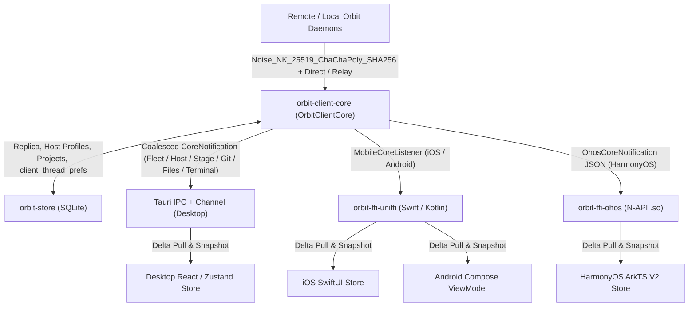

# Orbit Client Architecture & Client Bridge Protocol v2

This document describes the unified cross-platform architecture of Orbit across all four clients (**Desktop React/TS**, **iOS SwiftUI**, **Android Jetpack Compose**, and **HarmonyOS ArkTS V2**), anchored on **`orbit-client-core`** + **`orbit-store`** as the single authoritative data, persistence, and domain-logic layer.

---

## 1. Architectural Principles

1. **Single Authoritative Rust Core**:
   All domain logic, persistence, projection, ranking, and prompt construction live once inside `crates/orbit-client-core` and `crates/orbit-store`:
   - Multi-host connection pool, Noise NK encrypted tunnels (`orbit-crypto`), local replica SQLite storage, and event stream coalescing
   - Unified sidebar tree (`Needs Attention`, `Pinned`, `Projects`, `Launchpad`), git branch enrichment, worktree folding, filter/sort/search, and persisted thread `pinned` + `seen_seq` flags (`client_thread_prefs` in `orbit-store`)
   - Incremental conversation stage projection (`AgentStageDelta` / `TurnLiveSegment` with `Wakeup` & `StepGroup`)
   - Canonical provider fallback model catalogs, retired-slug migration, and effort resolution (`resolve_model_selection`)
   - Platform-filtered slash command catalog (`slash_commands`), fuzzy `@` mention candidate ranking (`rank_mention_candidates`), and prompt/workflow composition (`compose_prompt` including `/plan`, `/review`, `/compact`, `/btw`)
   - Detached multi-slot VT100 terminal emulation (`terminal_screen_slot`)
   - Conversation rewind (`rewind_agent`), workspace file preview (`read_workspace_file`), and side-question context & streaming (`build_side_question_context`, `ask_side_question`)
   - Pure-Rust native diagram rendering (`diagram.rs`: Mermaid via `mermaid-rs-renderer`, Graphviz DOT via `layout-rs`, XSS-sanitized inline SVG, deterministic SVG `id` namespacing, and a 128-entry LRU cache)
2. **Thin UI Presentation Clients**:
   Native clients own **only** view rendering, platform lifecycle/permissions, native pickers/haptics/keybindings, hardware-accelerated GPU layout transitions, and transient UI state (open sheets, draft text/attachments, local input focus).
3. **Standardized Contract v2 Across All 3 Bridges**:
   - **Desktop**: Tauri IPC commands & typed Channel events (`apps/desktop/src-tauri/src/lib.rs` -> `apps/desktop/src/lib/orbit-ipc.ts`)
   - **iOS & Android**: UniFFI v2 typed records/enums & `MobileCoreListener` (`crates/orbit-ffi-uniffi/src/lib.rs` -> `apps/ios/Generated/*` & `apps/android/.../uniffi/orbit_ffi_uniffi/orbit_ffi_uniffi.kt`)
   - **HarmonyOS**: N-API Contract v2 JSON DTO endpoints & `subscribeEvents` (`crates/orbit-ffi-ohos/src/lib.rs` -> `apps/harmony/entry/src/main/cpp/types/liborbit_ohos/index.d.ts`)

---

## 2. End-to-End Reactive Dataflow



### Pull-on-Notify Delta Flow

Bridges emit lightweight invalidation notifications (`CoreNotification`) containing only identifiers (`host_id`, `agent_id`, `cwd`, `slot`) rather than broadcasting full snapshot payloads over FFI on every token delta:

1. Daemon pushes streaming events to `OrbitClientCore`.
2. `OrbitClientCore` coalesces high-frequency events (for example, stage token streams and terminal output) and updates its SQLite-backed projections (`orbit-store`).
3. The platform bridge forwards a typed notification (`stage_updated`, `fleet_updated`, `host_updated`, `git_updated`, `files_updated`, `terminal_updated`, etc.).
4. The client store calls the corresponding incremental pull API (`agent_stage_delta`, `fleet_sidebar_request`, `git_review`, `terminal_screen_slot`) using its last applied `revision`, avoiding full-timeline re-serialization.

---

## 3. Client Bridge Protocol v2 Surface

All Contract v2 request/response DTOs are canonically defined in `crates/orbit-client-core/src/contract.rs` (plus `sidebar.rs`, `stage.rs`, `composer.rs`, `catalog.rs`, `diagram.rs`) and surfaced uniformly across the three bridges:

| Capability | Rust Core (`orbit-client-core`) | Desktop Tauri (`src-tauri`) | UniFFI (`orbit-ffi-uniffi`) | HarmonyOS N-API (`orbit-ffi-ohos`) |
| --- | --- | --- | --- | --- |
| Bridge version & caps | `BridgeInfoView` | `get_bridge_info` | `bridge_info()` | `bridgeInfoJson()` |
| Sidebar tree + search + prefs | `fleet_sidebar` / `FleetSidebarRequest` | `get_fleet_sidebar` | `fleet_sidebar_request` / `fleet_sidebar` | `fleetSidebarByRequestJson` / `fleetSidebarJson` |
| Incremental stage projection | `agent_stage_delta` / `AgentStageDeltaRequest` | `get_agent_stage` / `get_agent_stage_delta` | `agent_stage_delta_request` / `agent_stage_delta` | `agentStageDeltaByRequestJson` / `agentStageDeltaJson` |
| Thread seen / unread / pin | `mark_agent_seen`, `mark_agent_unread`, `toggle_pin_agent`, `seed_thread_prefs` | `mark_agent_seen`, `mark_agent_unread`, `toggle_pin_agent`, `seed_thread_prefs` | `mark_agent_seen`, `mark_agent_unread`, `toggle_pin_agent`, `seed_thread_prefs` | `markAgentSeen`, `markAgentUnread`, `togglePinAgent`, `seedThreadPrefsJson` |
| Model catalogs & effort resolution | `fallback_provider_catalogs`, `resolve_model_selection` | `get_fallback_provider_catalogs`, `resolve_model_selection` | `fallback_provider_catalogs`, `resolve_model_selection` | `fallbackProviderCatalogsJson`, `resolveModelSelectionJson` |
| Slash command catalog | `slash_commands(platform, query)` | `get_slash_commands` | `slash_commands(platform, query)` | `slashCommandsJson(platform, query)` |
| `@` Mention fuzzy ranking | `rank_mention_candidates` | `rank_mention_candidates` | `rank_mention_candidates` | `rankMentionCandidatesJson` |
| Prompt & workflow composition | `compose_prompt` | `compose_prompt` | `compose_prompt` | `composePromptJson` |
| Conversation rewind | `rewind_agent` | `rewind_agent` | `rewind_agent_request` / `rewind_agent` | `rewindAgentJson` |
| Workspace file viewer | `read_workspace_file` | `read_workspace_file` | `read_workspace_file_request` / `read_workspace_file` | `readWorkspaceFileJson` |
| Diagram detection & rendering | `detect_diagram_kind`, `render_diagram` (`diagram.rs`) | `render_diagram` | `detect_diagram_kind`, `render_diagram` | `detectDiagramKind`, `renderDiagramJson` |
| Side questions (`/btw`) | `build_side_question_context`, `ask_side_question` | `build_side_question_context`, `ask_side_question` | `build_side_question_context`, `ask_side_question` | `buildSideQuestionContext`, `askSideQuestion` |
| Session creation & prompting | `CreateSessionRequest`, `SendPromptRequest` | `create_agent`, `send_prompt` | `create_session`, `send_prompt_request` | `createSessionJson`, `sendPromptJson` |
| Lifecycle & connectivity | `on_app_foreground`, `on_app_background`, `on_network_changed` | `on_app_foreground`, `on_app_background`, `on_network_changed` | `on_app_foreground`, `on_app_background`, `on_network_changed` | `onAppForeground`, `onAppBackground`, `onNetworkChanged` |

---

## 4. Thread Preferences Persistence & Legacy Migration

Thread metadata (`seen_seq`, `is_pinned`, `pinned_order`, `updated_at_ms`) is persisted in the SQLite table `client_thread_prefs` inside `crates/orbit-store/src/lib.rs`, with cascade cleanup when a replica agent or host is removed:

- **One-Time Seed Migration**: Existing clients previously storing pins/seen markers in local UI storage (Desktop `localStorage`, iOS `UserDefaults`, Android `SharedPreferences`, HarmonyOS `OrbitPreferencesStore`) perform a one-time idempotent migration on launch by sending their legacy entries to `seed_thread_prefs`, then setting a local migration flag so SQLite remains the sole source of truth afterward.
- **Worktree Unread Propagation & Wakeup Dividers**: Both sidebar unread status and `TurnLiveSegment::Wakeup` timeline separators are derived consistently inside `orbit-client-core` and rendered across all four UIs (including explicit **Mark Unread** / **Pin** actions).

---

## 5. Four-Platform Ownership & Parity Matrix

| Feature / Domain | Rust Core (`orbit-client-core`) | Desktop (React/TS) | iOS (SwiftUI) | Android (Compose) | HarmonyOS (ArkTS V2) |
| --- | --- | --- | --- | --- | --- |
| Sidebar grouping, filter, sort, search | Computes `FleetSidebarView` | Renders `sidebarView` | Renders `sidebarView` | Renders `sidebarView` | Renders `sidebarView` |
| Thread pin & unread (`client_thread_prefs`) | SQLite CRUD + computation | `togglePinAgent` / `markAgentUnread` | `togglePinAgent` / `markAgentUnread` | `togglePinAgent` / `markAgentUnread` | `togglePinThread` / `markAgentUnread` |
| Provider fallback catalogs & slug cleanup | `catalog.rs` + `resolve_model_selection` | Thin store consumer | Thin store consumer | Thin store consumer | Thin store consumer |
| Slash commands & `@` mention ranking | `slash_commands` + `rank_mention_candidates` | Consumes Rust results | Consumes Rust results | Consumes Rust results | Consumes Rust results |
| Prompt `<WORKFLOW_INSTRUCTION>` & `/btw` | `compose_prompt` | Consumes `ComposedPrompt` | Consumes `ComposedPrompt` | Consumes `ComposedPrompt` | Consumes `ComposedPromptDto` |
| Stage projection & coalescing | `stage.rs` (`agent_stage_delta`) | Applies `changed_turns` delta | Applies `changed_turns` delta | Applies `changed_turns` delta | Applies `changed_turns` delta |
| Side questions (`/btw`) | `ask_side_question` stream | `SideQuestionPanel` | Contract v2 wired in store | Contract v2 wired in store | Contract v2 wired in store |
| Native diagrams (Mermaid / DOT / SVG) | `diagram.rs` (`mermaid-rs-renderer` + `layout-rs` + SVG sanitizer + LRU) | `DiagramBlock` + GPU lightbox | `DiagramBlockView` (`WKWebView`) + `fullScreenCover` | `DiagramBlockSurface` (`WebView`) + `Dialog` | `DiagramBlockView` (`@kit.ArkWeb`) + `bindSheet` |
| GPU Layout Animations | N/A | GPU `translate3d` push/pull shell | Native SwiftUI Navigation/Sheet | Compose AnimatedVisibility | ArkUI Sheet / Sidebar Motion |

---

## 6. Binding Synchronization & Verification Workflow

Whenever Rust FFI types in `crates/orbit-client-core` or `crates/orbit-ffi-uniffi` change, regenerate Swift and Kotlin bindings and run the workspace checks:

```bash
# 1. Regenerate iOS (Swift) and Android (Kotlin) UniFFI bindings
bash scripts/sync-bindings.sh

# 2. Rust formatting, strict Clippy, and workspace unit/integration tests
cargo fmt --all -- --check
cargo clippy --workspace --all-targets -- -D warnings
cargo test --workspace

# 3. Desktop Rust backend + TypeScript + Vite bundle
cargo clippy --manifest-path apps/desktop/src-tauri/Cargo.toml --all-targets -- -D warnings
(cd apps/desktop && npx tsc --noEmit && npm run build)

# 4. iOS Swift parse verification against generated UniFFI bindings
swiftc -parse apps/ios/Generated/orbit_ffi_uniffi.swift $(find apps/ios/Sources -name '*.swift' | sort)
```
